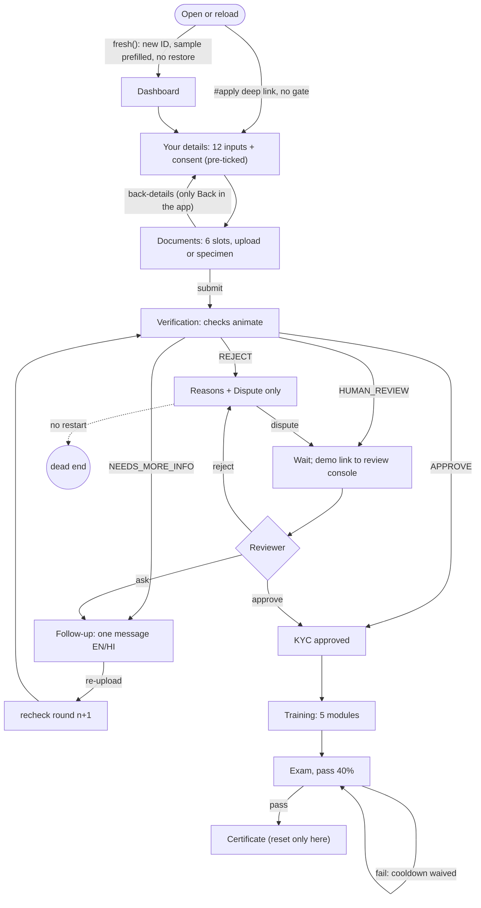

# PolicyNest: critical review against the focused-onboarding plan

- **Written:** 14 Nov 2026 by a review session (orchestrator plus six Sonnet lens agents). Read-only: no app file was changed, nothing was committed or deployed.
- **Scored against:** the plan `composed-hopping-swing.md`. Its steps: **S1** first-visit checklist; **S2** focus mode and the 30-minute sitting; **S3** autosave and resume; **S4** instant per-upload feedback; **S5** Onboarding Copilot (RAG plus proxy); **S6** small fixes (exam pass mark). "current" means today's app, independent of the plan.
- **What was reviewed:**
  - the live site https://policynest.embarko.app (each agent in its own browser tab). It is still the **pre-plan build**: `Last-Modified: Sat, 14 Nov 2026 12:45:18 GMT`, no focus bar in the HTML, and `/kb.json` and `/api/copilot` return 404;
  - the source `policynest_mvp/PolicyNest.html`, which **changed during the review** (1469 → 1528 → 1574 lines) because the build session is working in it. Line numbers are as read and may have shifted; findings I re-checked against the newest file say "re-checked".
- **Baseline:** `PolicyNest_project.zip` (13 Nov), extracted without `sample_specimens` (8 entries skipped, none opened).
- **Lens reports with full evidence:** in the side-session notes folder, as `LENS_FLOW.md`, `LENS_GUIDANCE.md`, `LENS_A11Y.md`, `LENS_USABILITY.md`, `LENS_DESKTOP.md` and `LENS_KPI.md`. Each finding below gives its ID from those files.
- **Labels:**
  - the usability findings come from an **expert heuristic walkthrough, not user data**;
  - "known behaviour" means platform behaviour that was not observed here;
  - "inferred" means not observed.
- **Numbers:** none here are invented. Every figure was measured in this review or copied from a named file.

---

## 1. Executive verdict

**The engine and the evaluation are solid. The applicant shell has some real-world gaps, and the plan as written has three design risks to settle before it is built.**

- **What holds up:**
  - The Evaluation page's numbers match `eval/out/*.json` and `eval/EVALUATION_REPORT.md`: the confusion matrix sums to 600, and 8.4 → 7.4 → 6.1 days, +106 agents and 0.38 min all trace to `simulation.json`. This was checked against the stored outputs; the engine was not re-run, because Node is absent.
  - The "in-sample" banner is honest.
  - The one consolidated follow-up message, in English and Hindi, is the clearest applicant text in the app.
  - The CSP already allows what the plan needs (`connect-src 'self' https: *`).
- **What fails today, before the plan:**
  1. Reload loses everything, although the follow-up message tells applicants to come back.
  2. A fresh load pre-fills another person's identity with DPDP consent **already ticked**.
  3. The test-harness controls sit in the applicant's path.
  4. A blurry document is cheered as "verified" at upload and refused only after Submit.
  5. The exam passes at 40%, against 50% in every source.
  6. Two Critical accessibility failures from the 14 Nov audit are still open: upload focus is invisible, and white text on orange measures 2.85:1. The agreed near-black fix is not implemented.
  7. The Dashboard's "Time to decision" and compliance ticks are not what they claim to be.
- **Plan risks to settle first:**
  - **(a) The 30-minute sitting's scope.** The plan doesn't say whether verification, the rework rounds, 15 hours of training or the exam sit inside it. Recommendation: details and documents only.
  - **(b) Focus-exit detection.** Watching `blur`, `visibilitychange` and `fullscreenchange` will misfire on phones (camera, picker, calls) and for screen-reader users. Logging "time away" is behavioural monitoring with no basis in the rulebook, so it is a DPDP purpose-limitation and minimisation problem.
  - **(c) Copilot guardrails.** The proxy in progress takes passages and context from the client and trusts `X-Forwarded-For` for rate limiting. Anyone with curl can use it as an open LLM relay, and the retrieval corpus contains internal "fraud desk" wording.

  None of these blocks the plan. Each has a concrete fix below.

---

## 2. Findings ranked by severity

Format: **ID · Severity · Plan step · Title.** Then the evidence, then the fix.

### Critical

1. **R1 · Critical · S3 · State is lost on reload, but the product tells applicants to come back** (U18, F1, U1)
   - **Evidence:**
     - Live: a full run to exam fail (`PN-2026-22575`) came back after reload as a new ID, `PN-2026-23299`, in DRAFT at step 1.
     - `fresh()` builds a new `S` (re-checked: `PolicyNest.html:514`). localStorage is used only for the theme (`:474`, `:1459`).
     - The follow-up text says "Upload them here: policynest.embarko.app/#apply. Everything else is already verified." Training is 15 hours.
   - **Fix:** S3 as planned. Resume must also cover `S.fu`, `S.changed`, `S.round`, `S.decision`, `S.mods`, `S.exam` with a last-fail time, `S.review`, `S.disputed` and `S.lang`. Each state needs its own landing point (table in §5). Until S3 ships, add a `beforeunload` warning after step 0.
2. **R2 · Critical · current/S1 · Another person's identity is pre-filled, with DPDP consent pre-ticked** (U2, U3, K14, F7)
   - **Evidence:**
     - `SAMPLE = {name:"Rahul Kumar Sharma", …, consent:true}` (re-checked: `PolicyNest.html:440`).
     - Live: `#f-consent.checked === true` on a fresh load. The Dashboard shows "Your agent card: Rahul Kumar Sharma, Gurugram" before the user types anything.
     - Opening `/#apply` lands straight on the form.
   - **Why it matters:** DPDP consent must be an affirmative act (regulatory matrix, line 20: "explicit consent"), and the Compliance card then reports "Consent recorded" (R9).
   - **Fix:** start with an empty form and consent off. Keep the sample behind a labelled "Demo: load sample applicant" control. Move consent into the S1 checklist, and send `#apply` to S1 when there is no consent record.
3. **R3 · Critical · current · Upload controls have no visible keyboard focus** (A11Y-01, earlier audit A-1)
   - **Evidence:**
     - `.vcard input[type=file]{position:absolute;width:1px;height:1px;opacity:0}` (re-checked: `:151`, `:159`).
     - Live: with `#up-PAN` focused, the "Upload file" label has outline none and box-shadow none.
   - **Fix:** use `.vbtns:has(input:focus-visible) label{outline:3px solid …}`, or a real `<button>` that calls `input.click()`. S4's one-document-per-page layout makes this the main control.
4. **R4 · Critical · current · White text on orange fails contrast in both themes; the agreed near-black fix is not in** (A11Y-02, earlier audit A-2)
   - **Evidence:**
     - The second `:root` block overrides the first: `--brand:#ff6b1a; --brand-ink:#ffffff` (re-checked: `:227`), and dark `#ff7a2e`/`#ffffff` (`:237`).
     - Measured 2.85:1 in light and 2.60:1 in dark. Near-black `#141414` gives 6.47:1 and 7.08:1.
     - White text on the hero gradient is 2.35–2.85:1, computed from the CSS.
     - CLAUDE.md (Phase 1–3, Contrast) records "text on orange fills is near-black".
   - **Fix:** set `--brand-ink:#141414` in both blocks. The S2 timer bar and the Copilot button must not reuse the failing pair.

### High

5. **R5 · High · S2 · The 30-minute sitting has no stated scope after Submit** (F3, F12)
   - **Evidence:** the plan times "details plus documents" but says nothing on verification (an animation of about 8 s), NEEDS_MORE_INFO rework (the 14-day rule, `03_APPLICATION_LIFECYCLE_STATE_MACHINE.md:60`), 15 hours of training, or the exam with its 24-hour retake gap. In the new source, `endSitting("SITTING_COMPLETE","Documents submitted")` (`:1387`) suggests the sitting ends at Submit, which is the right call, but the plan doesn't say so.
   - **Fix:** write it down: the timer and focus mode cover Details and Documents only. On Submit, leave focus mode and bring back the sidebar. A rework round has no 30-minute clock, only the 14-day expiry. Say this in the S1 checklist.
6. **R6 · High · S2 · Focus-exit detection will misfire on phones and for assistive tech** (D1, D2, D4, A11Y-04, F12)
   - **Evidence:**
     - Observed: no input has `capture`, so the selfie opens the OS chooser. Uploads go through `<label for>`, and a cancelled picker fires no `change`, so a flag cleared only on `change` (`PICKING=false`, `:1421`) stays set or misses.
     - Known behaviour, not observed: on Android Chrome the camera intent backgrounds the page; iPhone Safari has no element fullscreen; in-app browsers deny fullscreen; the Windows file dialog fires `blur`; screen-reader focus can leave the document.
     - Applicants also leave on purpose to read the WhatsApp/SMS follow-up.
   - **Fix:**
     - Don't warn on `blur`; use `visibilitychange` only.
     - Don't count "not fullscreen" as an exit, and offer "Start without full screen".
     - On touch devices, use no fullscreen and no exit warnings.
     - Clear the picker flag on `focus` returning or after a timeout, not only on `change`.
     - Consider a Wake Lock (available, D14) so the phone sleeping is not read as an exit.
7. **R7 · High · S2 · Logging focus exits with "time away" is surveillance-like and has no rule behind it** (KPI lens, Privacy)
   - **Evidence:** the plan logs `FOCUS_EXIT` with the round and the time away and shows it on the Audit trail. The plan itself (Context) calls the 30-minute sitting "our product choice, not a rule". DPDP requires purpose limitation and data minimisation (`REGULATORY_REQUIREMENTS_MATRIX.md:20`).
   - **Fix:** keep a count per sitting at most. Don't record time away or where the applicant went, and never use it in a decision or as reviewer evidence. Don't label it like a violation in the applicant-visible audit list. State the purpose in the S1 consent text, or drop it.
8. **R8 · High · S5 · The Copilot proxy can be used by anyone as a general LLM relay** (verified by me in `policynest_mvp/copilot_api/main.py`, in progress)
   - **Evidence:**
     - The browser sends `passages` and `context`, and the proxy pastes them into the prompt (`ask()`), so a caller can supply any "passages" and any question.
     - The `Origin` allow-list only stops browsers; curl can set any Origin.
     - The rate-limit key is the first `X-Forwarded-For` value (`main.py:126`), which the client controls, so the limit can be bypassed.
     - `null` is in the default allowed origins, which admits sandboxed iframes and `file://` pages from anywhere.
     - The default model is `claude-opus-5-5` (`MODEL = …`), but the plan says `claude-haiku-5-5`; this affects cost and latency per question.
     - `_hits` grows without bound.
   - **Fix:**
     - Do retrieval on the server: the proxy loads `kb.json` and takes only the question plus passage IDs, or it re-runs BM25 itself.
     - Validate `context` against a fixed schema of codes, not free text.
     - Take the client IP from the platform's trusted header only, or the last proxy hop.
     - Remove `null` from production origins.
     - Default to Haiku as the plan says.
     - Add a daily spend cap.
9. **R9 · High · S5 · The retrieval corpus contains internal fraud wording the Copilot could quote** (Guardrails §6.3)
   - **Evidence:** `build_site.py` puts the defect taxonomy, rulebook, rework spec and name-matching spec into `kb.json` (re-checked; the corpus list is in `build_site.py`). These include "Fraud Desk" and "flag to fraud desk" lines, for example rulebook §4.1 and §5 and taxonomy §2.3 and §3.2. Rulebook §8 and CLAUDE.md say applicants never see fraud wording.
   - **Fix:** tag chunks `audience: applicant | internal` at build time and retrieve only applicant-safe ones, or redact internal sentences. Also add an output filter for banned terms on the server.
10. **R10 · High · S5 · PII the applicant types into the question goes to the model** (Guardrails §6.5)
    - **Evidence:**
      - The plan sends "first name only" in the context, but the typed question is free text.
      - The proxy's system prompt asks the model not to repeat ID numbers, but nothing removes them before sending.
      - Rulebook §4.3 says never write the full Aadhaar number to any "system, log or prompt".
      - Event notes (`S.events[].note`), filenames and the rendered follow-up text carry DOB and names.
    - **Fix:**
      - Redact PAN, 12-digit and account-like numbers in the browser before sending.
      - Send codes, not event notes or filenames.
      - Keep `log_message` silenced (it is today).
      - Show a "don't type ID numbers here" hint.
11. **R11 · High · S4 · A poor-quality photo is cheered as verified at upload and refused only after Submit** (G1, U5)
    - **Evidence:** re-checked: for the specimen variant `blurry`, `d.ocr.conf = 0.61; d.status="ok"; cheerDoc(k)` (`:1319`). The §4.1 below-0.75 REUPLOAD check runs only inside `decide` (`:683`, `:688`). Live: "6 / 6" shows and Submit is enabled with a blurry marksheet.
    - **Fix:** this is exactly S4. Run the §4.1 confidence and missing-field checks in the per-upload card, and don't call `cheerDoc` when they fail.
12. **R12 · High · S6 · The exam passes at 40%; every source says 50%** (K10, F10, G6, U11)
    - **Evidence:**
      - App: re-checked at `PolicyNest.html:966` and the exam/fail lines; the live exam says "You need 40% or more to pass". Choosing the first answer on every question gave 40% and a certificate (U11, observed).
      - Sources:
        - `02_BUSINESS_REQUIREMENTS/02_POSP_ONBOARDING_PROCESS_CURRENT_STATE.md:28` ("50% (10/20)");
        - `06_DATA_DICTIONARY/COMPLETE_DATA_DICTIONARY.md:35`;
        - `07_…/03_APPLICATION_LIFECYCLE_STATE_MACHINE.md:31-32`;
        - `REGULATORY_REQUIREMENTS_MATRIX.md:39` ("e.g. 50%").
      - PRODUCT.md A7 still justifies 40% from the data pack's event text.
    - **Fix:** use 50% everywhere (UI, audit note, PRODUCT.md A7). On a 5-question paper that means 3 of 5. Store the fail time so a resumed exam can show the 24-hour cooldown. Without the fix, a Copilot grounded on 50% contradicts the screen.
13. **R13 · High · current · "Time to decision" is the length of an animation** (K1)
    - **Evidence:** the checks reveal at 320 ms each (`:1352`). `S.ttd` is shown as "Time to decision" beside "today 17.3 h" (re-checked: `:985`) and in the review console as "Time to decision (target under 10 min)" (`:1543`). `decide()` has already run before the animation.
    - **Fix:** measure from the last upload to the decision being available, i.e. OCR plus engine time, and label it "this demo, on this device". The 17.3 h baseline is queue wait only, so say so.
14. **R14 · High · current · The Compliance checklist ticks items it never checks** (K3)
    - **Evidence:** re-checked: `checklist()` sets `on = S.events.length>0`, which ticks "Consent recorded under the DPDP Act, 2023" and "Aadhaar kept as last four digits only" (`:946-947`). Neither looks at the consent box or at an Aadhaar upload. "No other POSP registration found" ticks on a simulated registry.
    - **Fix:** tie the items to `S.f.consent` plus its timestamp and to an accepted Aadhaar document. Label the registry item "simulated".
15. **R15 · High · current · The test harness sits in the applicant path** (U4)
    - **Evidence:** live documents step: "Use specimens for all", plus variant options such as "DOB one year off · T7", "Different person · T4" and "Company PAN (4th letter C) · T6".
    - **Fix:** put them behind a "Demo controls" disclosure that is off by default, or a `?demo=1` flag. They also defeat the S2 sitting.
16. **R16 · High · current · REJECT is a dead end** (F4, U22)
    - **Evidence:** re-checked: `rejectPanel()` (`:1197`) offers only `dispute`; `reset` appears only in other panels (`:1212`) and on the certificate. One rejection text says "reply to this message", but there is no reply channel.
    - **Fix:** add "Start a new application" and, after S3, "Delete my saved progress". Reword "reply" to the real channel.
17. **R17 · High · S5/current · Hindi covers only the follow-up and rejection messages** (G7, U14–U17)
    - **Evidence:** Hindi strings exist only in `followupItems`, `rejectReasons` and the reviewer ASK map. The form, `judge` refusals, validation errors, toasts, training, exam and certificate are English only. `<html lang>` stays `en`. BM25 over English passages returns nothing useful for a Romanised-Hindi question such as "mera PAN kaise upload kare" (inferred).
    - **Fix:** decide the scope and state it in S1. At minimum, the S4 feedback card and the proactive Copilot set should have Hindi. For Hindi questions, translate to English for retrieval or use canned answers. Engine strings stay canonical.

### Medium

18. **R18 · Medium · S3 · The resume landing point differs per state; the plan saves only "current step"** (F2, F11). See the table in §5. Thumbnails aren't saved, so `fixPanel` and the dashboard tiles need "verified earlier" placeholders. The new source already has that copy at `:1116`.
19. **R19 · Medium · current · Editing details after upload leaves every document marked "verified"** (F5)
    - **Evidence:** live: the name was changed to "Different Person" after six verified uploads, and the tiles stayed verified. `back-details` only calls `go(0)` (re-checked: `:1409`).
    - **Fix:** mark the affected documents "re-check" when name, DOB, PAN, Aadhaar last 4 or bank details change.
20. **R20 · Medium · S2 · The details form puts 12 inputs on one page, and the plan's page split leaves some out** (F6)
    - **Evidence:** 12 inputs (live DOM). The plan's pages leave out bank account, IFSC and consent.
    - **Note:** the newest source has progressive groups ("Your ID numbers", `:1071`); check that they include the bank group.
21. **R21 · Medium · current/S1 · The time estimates are invented and disagree** (K6, G5, U7)
    - **Evidence:** "About 2 minutes" (re-checked: `:966`), "It takes about five minutes" (`:1407`) and "Many agents pass on their second try" (`:1421`). None has a source. They break the no-invented-numbers rule and clash with a 30-minute sitting.
    - **Fix:** remove them.
22. **R22 · Medium · S4 · The whole Application view is a live region** (A11Y-06)
    - **Evidence:** `<section id="view-apply" aria-live="polite">` (`:425`, as read), rewritten with `innerHTML` on every render. With a timer and per-upload cards, screen readers would re-read large chunks.
    - **Fix:** use one short `role="status"` region, and move focus to the h1 on each step.
23. **R23 · Medium · S2 · The timer design must meet WCAG 2.2.1 and 2.2.2** (A11Y-04)
    - Warn at least 20 s before the end, and allow unlimited "+10 min" extensions plus an option to switch the limit off. The 20-hour and real-time exceptions don't apply.
    - Offer a hide control for the countdown (2.2.2).
    - Use `role="timer"` for the ticking text and announce only the 10-minute and 2-minute milestones through `role="status"`.
    - Use a native `<dialog>` for the 2-minute and expiry warnings; Escape means "keep working".
    - Tell users in S1 about the limit and how long progress is kept (2.2.6).
24. **R24 · Medium · S5 · Toasts and Copilot nudges will compete** (G11, G12)
    - **Evidence:** measured live: a clean run fires 9 toasts in about 25 s, at most 3 stacked. Each lasts a fixed 5.2 s with no pause on hover or focus. Both `#toasts` (`aria-live`) and each toast (`role="status"`) are live regions.
    - **Fix:** one channel per event. A success gets a toast; a problem gets the inline card plus a Copilot badge. The drawer never opens by itself. Drop the 5-minute warning, since 10-minute and 2-minute warnings already exist. Pause toasts on hover and focus.
25. **R25 · Medium · S4 · Refusals say what and how, but not why, and show classifier internals** (G3, U21)
    - **Evidence:** for example, "not recognised" shown next to "confidence 0.94". There is only one generic photo-quality message; the taxonomy's `IMAGE_GLARE` and `IMAGE_CROPPED` wording isn't used (G2).
    - **Fix:** S4 card in the order what / why / how, with taxonomy templates. Hide confidence and word counts from applicants.
26. **R26 · Medium · current · The applicant sees rule codes and enums** (U9, U10)
    - **Evidence:** the verification table shows "§4.1", "NEEDS_INFO" and "Tier 1 (Exact)", and "Review required" on a PAN that is "Approved". The masked line "Typed XXXXXX821K, card shows XXXXXX821K: one-character typing error" looks like a bug.
    - **Fix:** use plain labels for the applicant and keep the codes in the Audit trail.
27. **R27 · Medium · S5 · The Embarko proxy is unconfirmed** (D8)
    - **Evidence:** live `POST /api/copilot` and `GET /kb.json` return the generic static 404. `main.py` says it will be "its own Embarko server app", which is a separate origin.
    - **Fix:** ship retrieval-only mode first. A cross-origin proxy is allowed by the CSP (D9) but needs CORS (which `main.py` has) and the right origin list.
28. **R28 · Medium · S3 · Saved progress can't be guaranteed on iOS or in in-app browsers** (D6, D12)
    - **Evidence:** observed `navigator.storage.persisted() === false`. Eviction on Safari and in in-app browsers is known behaviour.
    - **Fix:** show "saved on this device" only after a successful write-and-read-back, and call `storage.persist()` after consent. The link friends will receive will probably open in WhatsApp's in-app browser, so show an "Open in Chrome/Safari" hint.
29. **R29 · Medium · current · Ops numbers sit on the applicant's dashboard** (U8, K2)
    - **Evidence:** "today 17.3 h" and "1m so far · today 8.4 days" (`S.started` is page load). The certificate compares minutes in the demo with a fleet median in days.
    - **Fix:** move the fleet benchmarks to Evaluation and Audit, and show the applicant only their own progress.
30. **R30 · Medium · current · Evaluation scoring details** (K4, K11, K12)
    - REJECT precision and recall of 60/60 include 11 cases routed to a person, but the confusion matrix has no Person column.
    - The "no gap found" fairness chip is hard-coded, and with 100% everywhere no gap could ever show.
    - The page leaves out PRODUCT.md's stricter "approved first time" figure of 60.7% (364/600).
    - **Fix:** add a Person column or split the counts, rename the chip to "no gap in-sample", and add the 60.7% row.
31. **R31 · Medium · current · Accessibility leftovers**
    - The light-theme focus ring is 2.85:1 on white (A11Y-03).
    - There is no skip link (A11Y-05).
    - Six identical "Upload file" and "Use specimen" names (A11Y-07).
    - The Documents step goes from h1 to h3 (A11Y-08).
    - No `aria-describedby` or `aria-invalid` on errors (A11Y-09).
    - At 375 px, the header plus nav take 255 px (A11Y-10).
    - The DRAFT pill is 3.27:1 (A11Y-11).
32. **R32 · Medium · S2 · Fullscreen needs a direct user gesture** (D3). Observed: a call made without activation threw "TypeError: Permissions check failed". Call it synchronously in the Start click handler and handle the rejection.

### Low

- **R33 · Low · current** Targets under 44 px on phones: buttons 32 px high, theme toggle 40 px; all pass the 24 px minimum (A11Y-12, U6). The selfie slot accepts PDFs and has no `capture="user"` (D10).
- **R34 · Low · current** The certificate has no download or print, and "Start a new application" wipes it (U12).
- **R35 · Low · current** The expected check count is hard-coded at 24, but the engine ran 23 live (K5). The gauge (`step/6`) and the journey bars use different progress measures (K8). "Checks passed" counts INFO as passed (K9).
- **R36 · Low · current** The simulation's 7.4 / 6.1 days and +106 differ from the package slides' 6.9 / 5.7 and +105 (`PS-01_PROBLEM_BREAKDOWN_SLIDES_SUMMARY.md:105, 339`), and the page doesn't explain the method (K15). The median counts certified agents only (1,732 of 3,000) (K16).
- **R37 · Low · current** The NAME_SPELLING_VARIANT follow-up mentions a declaration "format at the link below", but no template exists (G9). The follow-up asks applicants to "tell us which date is correct" but offers only an upload button (U20).
- **R38 · Low · S2** Real on-device OCR cost: one synthetic PAN took about 2.0 s from upload to "Verified" on an 8-core Windows desktop with a warm cache (measured, ±0.5 s polling). Low-end Android is unmeasured (D11).

---

## 3. Conflicts with the rulebook, DPDP and CLAUDE.md decisions

| Conflict | Where | Source |
|---|---|---|
| Exam pass mark 40% vs 50% | R12 | `02_…CURRENT_STATE.md:28`, data dictionary `:35`, state machine `:31-32`, regulatory matrix `:39` |
| 24-hour retake gap waived, and no fail time stored for resume | R12, F10 | state machine `:32`, regulatory matrix `:39` |
| Consent pre-ticked and reported as recorded | R2, R14 | DPDP explicit consent (regulatory matrix `:20`) |
| Focus-exit "time away" logging has no purpose basis | R7 | DPDP purpose limitation and minimisation (`:20`); the plan calls the sitting a product choice |
| Copilot could quote fraud-desk wording to applicants | R9 | Rulebook §8; CLAUDE.md "Face failures… applicant sees only a neutral message" |
| Typed ID numbers can reach the model prompt | R10 | Rulebook §4.3 ("never… to any system, log or prompt"); Aadhaar Act §29 via regulatory matrix `:40` |
| Auto-deleting expired saves vs 5-year record retention | S3 design | `IRDAI_REGULATORY_FRAMEWORK_REFERENCE.md:76` requires 5-year retention of KYC records after certification or termination. The on-device draft isn't the KYC archive, so deleting it is fine, but the plan's "log as DROPPED_OUT" event has to be kept somewhere server-side to count. In a static demo it can't be, so say so. |
| "No API keys" decision | S5 | CLAUDE.md "What the user asked for". The plan changes this deliberately, and CLAUDE.md must be updated (plan S6). The `.env` file now sits at the project root (exists, not opened). Any future zip of the project folder, like `PolicyNest_project.zip`, would include it. Exclude it explicitly when packaging. |
| Near-black on orange agreed but not built | R4 | CLAUDE.md Phase 1–3, Contrast |
| Invented time estimates | R21 | CLAUDE.md "Do not invent numbers"; plan S1 "no time estimates beyond the rules" |
| Copilot model default | R8 | Plan S5 says `claude-haiku-5-5`; `main.py` defaults to `claude-opus-5-5` |

---

## 4. Flow: current vs target

From `LENS_FLOW.md`, derived from the source and confirmed live where marked.

**Current applicant flow**



**Target flow from the plan, with the gaps found**

```mermaid
flowchart TD
  Open([Open]) --> Saved{Saved progress?}
  Saved -->|"yes, valid"| Resume["Resume: landing per state (R18)"]
  Saved -->|"expired 30 d / 14 d"| Drop[Delete + notice] --> S1
  Saved -->|no| S1["S1 checklist + consent"]
  S1 --> Start["Start (fullscreen optional, R6)"]
  Resume --> Sit
  Start --> Sit["Sitting: details pages, then one document per page + S4 card"]
  Sit -->|"timer 0"| End["Autosave; extend or resume later (R23)"] --> Sit
  Sit -->|"visibilitychange only (R6)"| Warn[Gentle banner, no penalty, count only (R7)] --> Sit
  Sit -->|Submit| Out["Leave focus mode (R5)"] --> Dec{Decision}
  Dec -->|NEEDS_MORE_INFO| Rew["Rework: 14-day clock, no timer"] --> Dec
  Dec -->|APPROVE| Tr[Training 15 h] --> Ex["Exam 50%, 24 h retake (R12)"] --> Cert[Certificate]
  Dec -->|REJECT| Rej["Reasons + Dispute + Start again (R16)"]
  Dec -->|HUMAN_REVIEW| Hum[Wait; resumable]
  Cop["Copilot: badge only, never auto-open (R24)"] -.-> Sit
```

---

## 5. Recommended resume landing table (for S3)

| Saved state | Land on | Timer |
|---|---|---|
| DRAFT, details incomplete | first incomplete details page | new 30-min sitting |
| DRAFT, documents incomplete | first missing or refused document | new sitting; verified documents show "verified earlier" |
| Submitted or in review | the verification result, without the animation | none |
| NEEDS_MORE_INFO | follow-up panel, round n, days left of 14 | none |
| HUMAN_REVIEW | human-review panel | none |
| REJECTED | reject panel with Delete / Start again | none |
| Training | training, hours kept | none |
| Exam after a fail | exam, showing when the retake opens | none |
| CERTIFIED | certificate | none |
| Expired | S1, with an "expired" notice | n/a |

---

## 6. Copilot: what it should say before the applicant asks

The `LENS_GUIDANCE.md` Part 5 set is rule-based and works without the model. Every message is a badge, and none opens the drawer:

1. Starting Documents: begin with the PAN, because everything is compared with it (§3, §4.1).
2. Wrong document type: say which slot it belongs in (§3).
3. Aadhaar front and back swapped (§4.3).
4. Unreadable photo: daylight, no flash, all four corners (§4.1).
5. A field not read (§4.1).
6. Selfie tips after a first failure; after a second, a neutral "a person will look" (§4.6, with no fraud wording).
7. NEEDS_MORE_INFO: fix everything together (§6, §8).
8. Bank proof in the applicant's own name (§4.5).
9. HUMAN_REVIEW: wait up to 4 working hours (§7).
10. Training needs 15 hours (§2).
11. After a failed exam: retake after 24 hours (§2).
12. Resume: what was kept and what wasn't, with a delete option.

The facts the app shows (pass mark, hours, retake gap, SLAs) should come from one constants table that `build_site.py` checks against `kb.json`, so the Copilot and the screen can't disagree (G6).

---

## 7. Baseline (13 Nov zip) vs current

| | Baseline (13 Nov) | Current folder (14 Nov, still being built) |
|---|---|---|
| `PolicyNest.html` | 716 lines, engine 3.2.0, no ENGINE block markers | 1574 lines at last read, engine 3.4.0, ENGINE block present |
| Flow | happy path only: no follow-up, re-check, reviewer, reject panel or dispute (grep counts 0) | all of these present |
| Persistence | none | none on the live site; the source now calls `persist()`, `focusUI()` and `endSitting()` (`:1252`, `:1387`), but their definitions were **not yet in the file** at 22:03, so the build is mid-way. Not a bug claim. |
| Exam | 40%, cooldown waived | same |
| Project files | no `PRODUCT.md`, `eval/`, `autoresearch/` or `planning/` | all present, plus `kb.json` built (47,646 bytes), `copilot_api/main.py`, `.env` and `.env.example` |
| `site/` | `index.html` plus shims | plus two Tesseract `.wasm` files and `kb.json` |
| `sample_specimens` | included in the zip (8 entries; not opened) | not opened |

What grew without being looked after: every new branch (follow-up, reject, human review) was added without back navigation, restart or persistence (F4, F9).

---

## 8. What could not be tested

- **None of S1–S5 on the live site**, because the deployed build predates them. Plan findings are design critique of the plan text and the in-progress source.
- **The agent-desktop CLI:** `node`, `npx`, `npm` and `agent-desktop` were all not found. Nothing was installed.
- **Real devices:** no Android, iOS or in-app-browser testing; picker, camera and `blur` events were not observed, because a programmatic picker needs a user gesture; no cold-cache OCR; no low-end phone timing.
- **Real screen readers** (NVDA, VoiceOver, TalkBack), Lighthouse or axe, and 200% zoom. Contrast on gradients was computed from the CSS, not sampled.
- **Not driven live:** the REJECT and HUMAN_REVIEW screens were read from the source only (the usability lens saw one reject page live). The toast dismiss size wasn't re-measured.
- **The engine wasn't re-run.** Evaluation figures were matched against the stored `eval/out` files.
- **No users.** The usability findings are one expert's walkthrough. A 5-participant moderated test plan is in `LENS_USABILITY.md`, with no results.
- **Not opened:** `.env`, `~/.embarko/credentials` and anything in `sample_specimens`.
