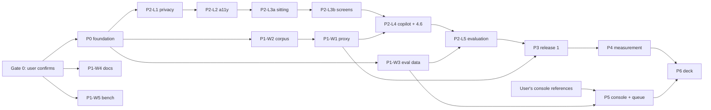

# PolicyNest onboarding: product requirements and build roadmap

- **Status:** draft for human review. Written 14 Nov 2026 by following Matt Pocock's `to-spec` skill. This folder has no issue tracker, so the spec is written here and not published, and the `ready-for-agent` label is not applied. **Nothing in this document is approved, and nothing gets built until the user says go** (CLAUDE.md, Phase 1–3 decisions).
- **Built on:** `RECONCILED_FINDINGS.md` (80 findings `RF-nn`, 18 contradictions `CX-nn`) and `GRILL_LOG.md` (46 decisions `G-nn`, every one marked "AI-answered — needs human confirmation"), plus `GLOSSARY.md` and `docs/adr/0001`–`0009`. The terms used below are the glossary's.
- **Source references:** "Brief" = `01_ORIGINAL_CHALLENGE/PS-01_CHALLENGE_BRIEF.md`; "RB §" = rulebook v3.2 section; "SM" = the state machine spec; "PRODUCT" = the goal IDs in `PRODUCT.md`; "Q-n" = the user's Phase 3 decisions (`planning/PHASE2_SPEC_AND_AUDIT.md` Part D).
- **One deviation from to-spec:** to-spec keeps file paths out of a spec. The roadmap (§16) is an exception, because the task asks for owned files per workstream. Everything above §16 is written without paths.
- **Honest labels:** every figure here is copied from a named file and labelled **in-sample**, **simulated**, **estimate** or **expert review**. No number was made up.

## Decisions confirmed by the user, 15 Nov 2026

A grill-me round with the user on 15 Nov (11 questions, all answered "yes") **narrowed this PRD and replaced its roadmap**. Where this section disagrees with anything below, this section wins. The requirements below are kept, not deleted; the ones outside the confirmed scope are now **nice to have**.

| # | Decision | Effect on this PRD |
|---|---|---|
| U1 | **The project is for the challenge judges first and for friends trying the link second.** Real-product hardening stays only where a judge or a friend would notice it. | Scope cut to the passes below; the rest is nice to have. |
| U2 | Accept the softer focus mode: no seconds recorded, closing full screen is not an exit, no full screen and no warnings on phones (G-04, G-05). | FR-06, FR-07 in pass 1. |
| U3 | Empty form, consent unticked, specimens and sample in a closed "Demo controls" panel; friends get `https://policynest.embarko.app/?demo=1` (G-06). | FR-01, FR-02 in pass 1. |
| U4 | **Order:** re-run the accuracy check on today's code first, then the accessibility fixes together with the small trust fixes, then the user's original list. The large privacy work moves to nice to have, except hiding the internal fraud-desk note from the applicant's history. | Replaces §16.4's order. |
| U5 | **A lighter build:** git repository, one editor at a time on the app file, engine fingerprint check after each change, **three passes**, no formal tickets, the main session merges (no separate integrator). | Replaces §16.1–§16.4. |
| U6 | Switch the AI answers on, after the server is fixed to look up rulebook passages itself. | Pass 3, done early (it does not touch the app file). |
| U7 | Keep **Opus 5.5 at effort `low`** (G-02). | FR-51 confirmed. |
| U8 | **Deploy after each pass**, each with the user's OK and a live check (T1–T10, engine fingerprint) (G-40). | §16.2 check pack after each deploy. |
| U9 | Before judging: **usability tests** and **the deck** (must); **adopting the 20 hand-decided cases** and **the held-out labels** (small); phone-photo bench only if time is left, and the deck says it was not tested. | Checklist below. |
| U10 | Exam pass mark **50%**, labelled "demo rule from the state machine"; ask the problem owner (G-01). | FR-34 label. |
| U11 | Shared understanding confirmed; update PRD and GRILL_LOG only. **Building still waits for a separate go.** | This section. |

Also decided by the user on 14 Nov (CLAUDE.md), and **already built and live** in the proxy: 20 questions per 10 minutes per client, a global cap of 30 per minute, **50 AI answers per UTC day** (not the 200 proposed in G-25), client address = second entry from the right of `X-Forwarded-For`, and no `null` origin. FR-50 is therefore built, pending a re-check. The proxy still accepts passages sent by the browser (checked 15 Nov); pass 3 fixes that.

### The confirmed plan

| Step | What | Requirements | Touches the app file? |
|---|---|---|---|
| 0 | Git repository with the ignore list; install Node; re-run the evaluation on today's engine and record its hash | FR-67, FR-58, FR-57 (runner side) | No (except region markers, optional) |
| Pass 3 (early) | Copilot server: look up applicant-safe passages itself, ignore passages from the browser, server-side output filter and ID-number check, passage audience tags in the build, proxy package without `.env*` or caches; then the user adds the key | FR-46 (server), FR-47, FR-48, FR-49 (server), FR-51, FR-65, FR-66 | No |
| Pass 1 | Accessibility and trust: contrast with near-black ink, upload focus, live region, skip link, headings, nav links, control names, phone top bar, targets; timer accessibility; softer focus mode; empty form and Demo controls; no "verified" pop-up on an unclear photo; invented time text removed; internal fraud-desk note hidden from the applicant's history | FR-41–FR-45, FR-05, FR-06, FR-07, FR-01, FR-02, FR-03, FR-16, FR-36, FR-55. AI-proposed additions, **not yet confirmed**: FR-27 (reject panel restart), FR-38 (honest compliance ticks) | Yes |
| Pass 2 | Honest numbers: time to decision, fleet numbers off applicant screens, engine hash on the Evaluation page and in the audit, "in-sample" labels, routed-to-a-person counts, fairness chip, 60.7% row, process map | FR-23, FR-37, FR-56, FR-57 (page), FR-59, FR-61 | Yes |
| Then, the user's original list | Queue data; §4.6 two-selfie-failures rule; held-out set; process map (done in pass 2); specimen prints and photo bench (optional); deck last | FR-62, FR-63, FR-31, FR-60, FR-72, FR-70 | FR-31 yes; the rest no |
| Docs, at each step's end | Fix the stale lines in PRODUCT.md, CLAUDE.md, the usability plan and MISSING_SOURCE_MATERIALS.md; discovery questions | FR-68, FR-69 | No |
| Gated | Console redesign, queue screens, A/M/R keys (waiting for the user's references) | FR-64 | Yes, later |

**Order of work:** step 0 → pass 3 (can run while pass 1 is built, because it touches different files) → pass 1 → pass 2 → the original list. Each pass ends with the user's OK, a deploy and the live check.

**Nice to have** (kept in §6, not scheduled): FR-04 changes, FR-08 changes, FR-09–FR-13 (saved-progress allow-list, read-back, resume landing, expiry copy, delete control), FR-15, FR-17, FR-18, FR-24, FR-25 copy, FR-33, FR-34 cooldown, FR-35, FR-39, FR-40, FR-46 client side, FR-53, FR-54. Regression items (FR-14, FR-19–FR-22, FR-26, FR-28–FR-30, FR-32, FR-52) must keep passing.

### Before-judging checklist

- [ ] Step 0, passes 1–3 deployed and checked live
- [ ] AI key added; one supervised round of answers checked against the guardrails
- [ ] Usability tests: 5 applicants, 2 reviewers; results in `planning/usability/results.csv` with codes only (FR-71)
- [ ] A team member adopts or overrules each of the 20 hand-decided cases (FR-73)
- [ ] Held-out labels made by the user and frozen; evaluation reported separately (FR-60)
- [ ] Executive deck, every number traced, accuracy "in-sample", simulation "directional" (FR-70)
- [ ] Optional: phone-photo bench (FR-72); if skipped, the deck says OCR on phone photos was not tested
- [ ] PRODUCT.md statuses updated only for what was checked live

## Contents

1. Problem statement · 2. Solution · 3. Users · 4. Goals and non-goals · 5. User stories · 6. Functional requirements · 7. Guardrails · 8. Data and privacy · 9. Copilot, retrieval and the key-holding proxy · 10. Implementation decisions · 11. Testing decisions · 12. Metrics · 13. Risks · 14. Open questions for the human · 15. Out of scope · 16. Roadmap for a multi-agent build · 17. Traceability · 18. Further notes

---

## 1. Problem statement

PolicyNest (a fictional broker; all data synthetic) onboards about 330 would-be POSP agents a month. Between January and September 2026, 3,000 started and 1,732 (57.7%) were certified. A certified agent takes a median of 8.4 days. A file waits a median of 17.3 hours before a reviewer opens it. A reviewer spends about 21 minutes per file reading documents by eye. When a document is wrong, the applicant hears about it a day later, often one fix at a time, and 27.3% of returned applicants never reply (Brief §2, Table 3; `stage1/STAGE1_PACK.md` Part 1).

The applicant's experience: they type details nobody checks, upload six photos, and wait. When something is wrong, they find out late and may have to come back several times. Nobody tells them why a photo failed until a person looks at it. The reviewer's experience: they re-read clean files all day, and the hard cases (names, faces, unlisted boards) get the same time as the easy ones.

The MVP already proves most of the brief (PRODUCT §4: Built). It still has gaps that matter to a scorer, a compliance officer or a first-time applicant:

- the headline accuracy is not pinned to the code that runs (RF-01);
- another person's identity and a ticked consent greet every new applicant (RF-02);
- autosave keeps more personal data on the device than it needs (RF-03);
- the Copilot proxy would become an open model relay the moment a key is added (RF-10);
- two accessibility failures from the audit are still open (RF-40, RF-41);
- several screens make claims they cannot back (RF-04, RF-29, RF-33).

## 2. Solution

An AI-first onboarding product, run in the applicant's browser:

1. A short checklist and consent (one ideal case, synthetic data, nothing pre-filled).
2. A focused 30-minute sitting for typed details and documents that never wipes work.
3. Real on-device OCR with a type gate per slot, and instant feedback on every document.
4. The rule engine decides from the documents (the PAN card is the anchor) and cites a rule for every reason.
5. One consolidated follow-up in English or Hindi; re-checks of changed documents only.
6. Every human-only decision routed to a reviewer with the evidence side by side.
7. Training and exam placeholders, then a demonstration certificate.

Alongside the journey:

- a Copilot that guides from the rulebook and the applicant's own progress, and never decides;
- an audit trail a compliance officer can read;
- an Evaluation page whose every number names how it was measured.

This PRD hardens what exists (privacy, honesty, accessibility, the proxy), adds the remaining brief items that can be built now (the §4.6 selfie rule, queue data, a held-out evaluation, the process map), and sets the order in which agents can build all of it safely in parallel.

## 3. Users

| Priority | User | Needs | Served by |
|---|---|---|---|
| Primary | **Applicant** (phone first; many prefer Hindi for messages) | Know what to do, get certified fast, fix everything once, trust what they are told | Checklist, sitting, document slots with instant feedback, follow-up, Copilot, certificate |
| Secondary | **Reviewer** | Spend time only on judgement calls, with evidence laid out | Review console (one case now; a queue after the references arrive) |
| Tertiary | **Ops lead** | Queue age, decision mix, overrides, drop-off by stage | Evaluation page (process map, decision mix); queue KPIs later |
| Tertiary | **Compliance officer** | No ineligible person certified; every decision explainable | Audit trail, Evaluation page (accuracy, fairness, engine hash) |
| Also | **Demo visitor** (the user's friends, a judge) | Run any scenario without real documents | Demo controls, `?demo=1` |

## 4. Goals and non-goals

### Goals

| # | Goal | Measured by |
|---|---|---|
| G1 | Every brief Must-have and Should-have works on the public URL | §6 acceptance criteria; T1–T10 |
| G2 | No personal data beyond what the journey needs, anywhere (device, prompts, logs) | FR-09, FR-46–FR-50, FR-55 |
| G3 | Every number shown is true and labelled with how it was measured | FR-23, FR-36–FR-40, FR-57–FR-59 |
| G4 | Every human-only decision goes to a person, with no fraud wording to the applicant | FR-29–FR-33, FR-47, FR-48 |
| G5 | WCAG 2.2 AA on the applicant journey in both themes at 375 px and 1280 px (manual audit; not a conformance claim) | FR-41–FR-45 |
| G6 | Accuracy that is reproducible on the exact code that runs, and a first out-of-sample figure | FR-57, FR-58, FR-60 |
| G7 | A build that several agents can run in parallel without overwriting each other | §16 |

### Non-goals

- Real PAN, penny-drop, face-match, IRDAI or DigiLocker calls (Brief "Out of scope"; ADR 0008).
- A server-side application store, accounts or logins (ADR 0003).
- The training course and the real exam (Brief "Out of scope").
- The review-console redesign, the queue screens and the A/M/R keys **until the user's references arrive** (Q2, G-22).
- Hindi screens and pop-ups (PRODUCT S4, G-13).
- Fraud investigation beyond an internal referral (Brief "Out of scope").

## 5. User stories

**Applicant: starting**
1. As an applicant, I want an empty form when I start, so that I never see someone else's identity.
2. As an applicant, I want to tick consent myself, so that agreeing is my own act.
3. As an applicant, I want a list of the six documents and what gets one refused before I start, so that I can gather them first.
4. As an applicant, I want to know what will be saved on my phone and for how long, so that I can decide whether to allow it.
5. As an applicant on a shared phone, I want to start without saving, so that the next person cannot see my details.
6. As an applicant, I want to know that messages come in English or Hindi and the screens are in English, so that I am not surprised.

**Applicant: the sitting**
7. As an applicant, I want a 30-minute sitting that I can extend as often as I need, so that a slow upload does not lose my place.
8. As an applicant, I want to switch the timer off or hide it, so that a countdown does not stress me.
9. As an applicant on a phone, I want to work without full screen, so that the camera and my messages still work.
10. As an applicant, I want leaving the screen to cost me nothing, so that reading a WhatsApp message is not punished.
11. As an applicant using a screen reader, I want the timer announced only at 10 and 2 minutes, so that it does not talk over the form.

**Applicant: documents**
12. As an applicant, I want each slot to refuse the wrong document and say which slot it belongs in, so that I can fix it at once.
13. As an applicant, I want to be told straight after an upload what was read, what is fine and what to fix, so that I don't wait for Submit.
14. As an applicant, I want a blurry photo not to be called "verified", so that I am not misled.
15. As an applicant, I want the reason a photo failed (glare, cropped, blurry) and how to retake it, so that the second try works.
16. As an applicant, I don't want confidence scores or word counts, so that the message stays plain.
17. As an applicant, I want documents marked "re-check" if I change my details afterwards, so that nothing stays wrongly verified.
18. As an applicant, I want the selfie slot to open the front camera on my phone, so that I take a live photo.

**Applicant: decision and follow-up**
19. As an applicant, I want one message listing everything to fix, so that I fix it once.
20. As a Hindi-preferring applicant, I want that message in Hindi, so that I understand it.
21. As an applicant, I want only the documents I fixed to be checked again, so that the rest stays approved.
22. As an applicant, I want plain words instead of rule codes on my screen, so that I understand my result.
23. As a rejected applicant, I want plain reasons with no accusation, so that I keep my dignity.
24. As a rejected applicant, I want to dispute the decision, so that a person looks again.
25. As a rejected applicant, I want to start again or delete my saved progress, so that I am not stuck.
26. As an underage applicant, I want the date from which I can apply again, so that I know when to return.
27. As an applicant whose case is with a person, I want an honest statement of what happens next, so that I don't expect a promise nobody tracks.
28. As an applicant whose selfie failed twice, I want a neutral "a person is checking" message, so that I am not made to feel accused.

**Applicant: returning**
29. As a returning applicant, I want to land where I left off (details, a missing document, my follow-up, the exam retake time), so that I continue at once.
30. As a returning applicant, I want to see that my verified documents were kept, so that I don't upload them again.
31. As a returning applicant, I want "saved" to mean saved, so that I can trust it.
32. As an applicant opening the link inside WhatsApp, I want a hint to open it in my browser, so that my progress survives.
33. As an applicant whose save expired, I want a notice and a fresh start, so that I know what happened.

**Applicant: training, exam, certificate**
34. As an applicant, I want to know the pass mark and the retake gap before the exam, so that there are no surprises.
35. As an applicant who failed, I want to see when the retake opens, also after I come back, so that I can plan.
36. As a certified applicant, I want to print or save my certificate, so that I can keep it.

**Applicant: Copilot**
37. As an applicant, I want suggestions about my next step without asking, so that I am not stuck.
38. As an applicant, I want suggestions as a badge, not a pop-up that covers my work, so that I stay in control.
39. As an applicant, I want answers that cite the rulebook, so that I can trust them.
40. As an applicant, I want the Copilot to refuse to predict my decision, so that I am not misled.
41. As an applicant, I want to be stopped if I type my PAN or Aadhaar into the chat, so that it is not shared.
42. As an applicant, I want rulebook answers even when the AI is not connected, so that help is always there.
43. As an applicant, I want the Copilot and the screen to state the same pass mark, hours and gaps, so that they never contradict each other.

**Reviewer**
44. As a reviewer, I want only human-only cases routed to me, so that I don't re-read clean files.
45. As a reviewer, I want the AI's recommendation and the evidence side by side, so that I decide quickly.
46. As a reviewer, I want to approve, ask for more, or reject with a required note, so that every decision is explained.
47. As a reviewer, I want a confirmed different person referred internally while the applicant gets a neutral message, so that the fraud desk is involved without accusing anyone.
48. As a reviewer, I want two selfie failures in a row routed to me with an internal referral, so that the rulebook's §4.6 is followed.
49. As a reviewer, I want disputes to show the original reasons, so that I can uphold or overturn fairly.
50. As a reviewer, I want my approval kept on later re-checks while the evidence is unchanged, so that I don't decide twice.
51. As a reviewer, I want a queue of routed cases with why each was routed and its simulated age, so that I can work in order (gated on references).
52. As a reviewer, I want keyboard shortcuts that don't clash with browser help, so that I work fast (gated).

**Ops lead and compliance officer**
53. As an ops lead, I want today's process map with time and loss per step, so that I see where applicants stall.
54. As an ops lead, I want the decision mix and the share routed to a person, labelled in-sample, so that I can plan staffing.
55. As a compliance officer, I want every decision with its rule, round, engine version and engine hash, so that I can audit it.
56. As a compliance officer, I want internal events marked internal and kept off the applicant's screens and device, so that nothing leaks.
57. As a compliance officer, I want the compliance checklist to tick only what was checked, so that it is evidence, not decoration.
58. As a compliance officer, I want accuracy shown with the hash of the code it measured, so that I know it applies to what runs.
59. As a compliance officer, I want a fairness check that says "in-sample" and could show a gap, so that it is honest.
60. As a compliance officer, I want an out-of-sample accuracy figure from cases labelled before the engine saw them, so that I can trust the claim.

**Demo visitor and team**
61. As a demo visitor, I want a link that opens the demo controls, so that I can run T1–T10 without real documents.
62. As a demo visitor, I want test labels only inside the demo controls, so that the applicant view stays clean.
63. As the team, I want the 20 hand-decided cases adopted or overruled by a team member, so that the Stage 1 claim is ours.
64. As the team, I want discovery questions written down with today's assumption for each, so that the meeting is ready when it happens.
65. As the team, I want an executive deck whose every number traces to a file, so that the defence holds.

## 6. Functional requirements

Each requirement has acceptance criteria (checked on the live site after deploy unless stated), its sources and its build phase (§16). **Status:** **R** = regression only (built; must keep working), **N** = new or changed work, **G** = gated (waits on a person or on references).

### 6.1 Starting and consent

| ID | Requirement | Acceptance criteria | Sources | Status · Phase |
|---|---|---|---|---|
| FR-01 | A new application starts with every typed field empty and both consents (onboarding and saving) unticked. | Fresh load in a private window: every input empty; `#f-consent` unchecked; Dashboard shows no person's name; Compliance card shows consent "not given". | Brief §8 (DPDP); RF-02; G-06 | N · P2-L1 |
| FR-02 | Specimen controls, variant pickers and "Load the sample applicant" live in one **demo controls** disclosure, collapsed by default and opened by `?demo=1`; test labels ("· T4") appear only inside it. | Without `?demo=1`: no variant picker or T-label visible; one closed "Demo controls (synthetic documents)" disclosure per documents page. With `?demo=1`: open; T1–T10 runnable as today. | CLAUDE.md (specimens); RF-25; CX-18; G-06 | N · P2-L1 |
| FR-03 | The first-visit checklist lists the six documents, what is accepted, what gets a document refused (RB §3–4), the steps after documents (RB §2: 15 h, exam, 24 h retake), what is saved and for how long, the sitting's scope (details and documents only), the language split, and a shared-device line. | Checklist text covers each item; no time estimate that is not a rule. | PRODUCT A11; RF-29; G-13; G-16 | N (content) · P2-L1 |
| FR-04 | Save consent is separate from onboarding consent and optional; without it nothing is written to the device. | With save consent off, after a full run, the device store holds no PolicyNest key. | PRODUCT A13; ADR 0003 | R · P2-L1 |

### 6.2 The sitting and focus

| ID | Requirement | Acceptance criteria | Sources | Status · Phase |
|---|---|---|---|---|
| FR-05 | A sitting covers typed details and documents only, lasts 30 minutes, warns at 10 and 2 minutes, extends by 10 minutes any number of times, can be switched off, and the countdown can be hidden. It ends at Submit. | Timer test with an overridden clock: warnings at 10 and 2 min; "+10 min" works at least 5 times; "turn off the time limit" removes the countdown; Submit ends the sitting and restores the sidebar. | WCAG 2.2.1, 2.2.2; PRODUCT A12; RF-22; RF-19 | N · P2-L3a |
| FR-06 | On desktop, only a hidden page during a sitting is a focus exit. It shows a gentle warning, logs `FOCUS_EXIT` with no duration, increments a count, and never resets anything. Closing full screen shows a "return to full screen" banner and is not an exit. | Simulated `visibilitychange`: one `FOCUS_EXIT` event whose note contains no number of seconds; warning text has no duration; closing full screen adds no event. | RF-05; RF-20; ADR 0004; G-04 | N · P2-L3a |
| FR-07 | On touch-first devices (coarse pointer), the sitting requests no full screen and shows no exit warnings; every device offers "Start without full screen". The full-screen request runs inside the Start click and its failure falls back quietly. | Mobile emulation at 375 px: Start enters the sitting without full screen; tab switch produces no modal; desktop "Start without full screen" works; a rejected request logs nothing and shows no error. | RF-20; RF-23; RF-24; G-05 | N · P2-L3a |
| FR-08 | The file picker and camera never count as a focus exit (flag set on the upload click, cleared on window focus or after a timeout). | Open and cancel the picker: no warning. | PRODUCT A12; RF-20 | R · P2-L3a |

### 6.3 Saved progress and resume

| ID | Requirement | Acceptance criteria | Sources | Status · Phase |
|---|---|---|---|---|
| FR-09 | Saved progress holds only an **allow-list** of fields that resume or the engine read. Never: images, thumbnails, raw OCR text, a full Aadhaar number, internal events, the typed full bank account (last four only). The consent text names what is kept. Saves made by the earlier format are discarded on load, with a notice. | A test lists every key in the saved copy and compares it with the allow-list; no 12-digit run; no value equal to the typed full account number; no internal event; an old-format save is removed and the notice shows. | DPDP (Brief §8); RB §4.3; RF-03; ADR 0003; G-03 | N · P2-L1 |
| FR-10 | "Saved on this device" shows only after a write and a successful read-back; persistent storage is requested after consent; an in-app browser shows "open in Chrome or Safari to keep your progress". | With storage blocked: no "saved" claim, a "could not save" note instead. In-app browser user agent: hint visible. | RF-07; G-28 | N · P2-L1 |
| FR-11 | On resume, the applicant lands per the resume table: first incomplete details page; first missing document; verification result (no animation); follow-up panel with round and days left of 14; human-review panel; reject panel; training with hours kept; exam with the retake time; certificate; or the checklist with an "expired" notice. Restored documents show "verified earlier". | One browser check per row of the table (10 cases). | SM §2; RF-21; G-27 | N · P2-L1 |
| FR-12 | Saves expire after 30 days in DRAFT and 14 days once a follow-up is open, and are deleted with a notice. The demo claims no DROPPED_OUT event and no five-year retention. | Clock override: 31-day DRAFT save → deleted, notice; 15-day follow-up save → deleted. Copy contains no retention claim. | SM §2; RF-08; ADR 0003 | R + N (copy) · P2-L1 |
| FR-13 | "Delete my saved progress" is reachable from the top bar, the Copilot and the reject panel, and removes every PolicyNest key from the device. | After delete, the device store holds no PolicyNest key; a new application starts. | DPDP erasure; PL S3; RF-27 | N · P2-L1 |

### 6.4 Documents and instant feedback

| ID | Requirement | Acceptance criteria | Sources | Status · Phase |
|---|---|---|---|---|
| FR-14 | Six slots; each accepts only its own document type and refuses anything else with the slot it belongs in. | Upload a synthetic PAN into the Aadhaar slot: refused, "This looks like a PAN card…". | PRODUCT A3, A4; Brief Must-have | R · all |
| FR-15 | Instant feedback after each upload, ordered what / why / how, using the taxonomy's wording for glare, crop and blur, never showing confidence values or word counts to the applicant. | Blurry specimen: card says the photo is not clear, why, and three numbered retake steps; no "confidence" text on applicant screens. | PRODUCT A14; RF-31; G-18 | N · P2-L3b |
| FR-16 | The success toast fires only when the document's feedback has nothing to fix and nothing stopping; otherwise the tile reads "needs a clearer photo" (or the fix). | Blurry specimen: no "verified" toast; tile shows the fix. Clean specimen: toast as today. | RB §4.1; RF-26; G-09 | N · P2-L3b |
| FR-17 | Changing name, DOB, PAN, Aadhaar last four, account or IFSC after documents exist marks affected documents "re-check" and refreshes their feedback; a PAN change re-checks everything anchored on the PAN. | Upload six specimens, edit the name: affected tiles show "re-check"; Submit re-runs those checks. | RF-28; CX-08; G-15 | N · P2-L3b |
| FR-18 | The selfie slot accepts images only and hints the front camera on phones. | Selfie input refuses a PDF with a reason; phone emulation offers the camera. | RF-36 | N · P2-L3b |
| FR-19 | A document with OCR confidence below 0.75 is untrusted (re-upload; its values are not used). Raw OCR text is never stored. Aadhaar is masked to the last four everywhere. | T5 still asks for the marksheet again; no raw text in the saved copy (FR-09 test). | RB §4.1, §4.3; PRODUCT D4, D5 | R · all |

### 6.5 Decision, engine and follow-up

| ID | Requirement | Acceptance criteria | Sources | Status · Phase |
|---|---|---|---|---|
| FR-20 | The engine block keeps its interface and stays pure. A lane changes it only if its brief says so, and any change re-runs the evaluation. Every check cites its rule; the three outcomes follow RB §6 (any REJECT → REJECT with every reason; else any needs-info or re-upload → NEEDS_MORE_INFO; else APPROVE). | Engine hash unchanged after every lane that does not own it; T1–T10 pass. | Brief Must-have; RB §6; ADR 0001 | R · all |
| FR-21 | The PAN card's read values are the anchor; typed values are compared and reported as information only. | T9-style typed mismatch is information only. | RB §3; ADR 0009 | R |
| FR-22 | When unsure, the engine prefers NEEDS_MORE_INFO to REJECT. | Evaluation: no REJECT where truth is NEEDS_MORE_INFO. | Brief §8; RB §5 | R |
| FR-23 | Time to decision is measured from the later of the last accepted required document and Submit, to the moment the decision exists (excluding the reveal animation), and is labelled "this demo, on this device". The queue baseline is not shown beside it on applicant screens. | The shown value is under the animation length for a clean run; label present; no "today 17.3 h" chip on applicant views. | Brief Table 7; RF-33; G-11 | N · P2-L3b |
| FR-24 | Applicant screens show plain labels for checks; rule sections, check-result codes and name tiers appear in the Audit trail and the console, with a "Why?" link to the rule for the applicant. | No "NEEDS_INFO", "Tier", "§" text in the applicant's verification view except behind "Why?". | RB §8; RF-30; G-18 | N · P2-L3b |
| FR-25 | One consolidated follow-up in English or Hindi lists every fix; the spelling-variant message uses the rulebook wording without "attached format" until a template exists; a DOB mismatch offers the upload route the message names. | T5 shows two fixes in one message; T3 text matches RB §8 minus the template clause; T7 message asks for a document, not a free-text answer. | Brief Must-have; RB §8; RF-37; CX-09 | R + N (copy) · P2-L3b |
| FR-26 | A re-upload re-reads only changed documents and re-runs only their checks; the rest is "carried over"; both rounds are in the Audit trail. | T10 passes. | Brief Should-have; PRODUCT F2, F3 | R |

### 6.6 Rejection, dispute and human routing

| ID | Requirement | Acceptance criteria | Sources | Status · Phase |
|---|---|---|---|---|
| FR-27 | The reject panel offers Dispute, "Start a new application" and "Delete my saved progress"; text never says "reply to this message"; an underage rejection gives the date from which the person may apply again. | T6: three actions present; underage specimen shows a date (18th birthday). | RB §8; RF-27; G-10 | N · P2-L3b |
| FR-28 | A dispute routes the case to a reviewer, who can uphold, ask or overturn. | T6 → Dispute → console shows Uphold / Ask / Overturn. | RB §9; PRODUCT C6 | R |
| FR-29 | A different person's name (NAME_MISMATCH) goes straight to a person; never auto-rejected. | T4 routes to the console; decision is a recommendation. | RB §5, §9; Brief §8 | R |
| FR-30 | Other human-only items (surname change, face 0.60–0.75, unlisted board) go to a person once the applicant's fixes are in. | T8 routes to the console. | RB §9; PRODUCT R2 | R |
| FR-31 | Two face-match scores below 0.60 in a row (per application, across rounds; a score of 0.60 or more resets the run) route the case to a reviewer with an internal fraud-desk referral event; the applicant sees only "a person is checking a few details". Counted outside the engine block. | Selfie variant 0.52 → follow-up; second 0.52 → human-review panel with neutral text; one internal referral event; engine hash unchanged. | RB §4.6, §7; Q6, Q18; RF-53; G-35 | N · P2-L4 |
| FR-32 | The reviewer task shows the AI recommendation and the evidence side by side, needs a note to reject, and keeps an approval on later re-checks while the evidence is unchanged; touches and reviewer time are logged. | T4, T8 and a dispute decided in the console with the evidence visible. | Brief Must-have; PRODUCT R3–R5 | R |
| FR-33 | The human-review panel states the rulebook target honestly: "We aim to reply within 4 working hours (our service target)". | Text says "aim" and "target"; no countdown implying tracking. | RB §7; RF-56 | N · P2-L3b |

### 6.7 Training, exam and certificate

| ID | Requirement | Acceptance criteria | Sources | Status · Phase |
|---|---|---|---|---|
| FR-34 | The exam pass mark (50%) and the 24-hour retake gap come from the facts table; a failed attempt stores its time; the exam screen shows when the retake opens, also after resume; "Demo: skip the 24-hour wait" lives in the demo controls. | Fail at 40% → retake time shown; reload → still shown; demo skip works only with demo controls open; 60% passes. | RB §2; SM; ADR 0005; RF-34; G-01; G-29 | N · P2-L3b |
| FR-35 | The certificate can be printed or saved as PDF through the browser, and "Start a new application" asks for confirmation first. | Print preview shows only the certificate; the reset asks first. | RF-35 | N · P2-L3b |

### 6.8 Honest screens

| ID | Requirement | Acceptance criteria | Sources | Status · Phase |
|---|---|---|---|---|
| FR-36 | No time estimate or success claim that is not a rule appears anywhere ("About 2 minutes", "Many agents pass on their second try" removed). | A text check over the built page finds none of a maintained list of banned phrases. | CLAUDE.md; RF-29; G-16 | N · P2-L3b |
| FR-37 | Fleet benchmarks and fixed check counts appear only on the Evaluation page; applicant screens show the applicant's own progress, one progress measure, and count only passed checks as passed. | Dashboard and certificate contain no "today 17.3 h" or "8.4 days"; the gauge and journey bars agree; "checks passed" excludes information-only results. | RF-32; RF-50; G-31 | N · P2-L5 |
| FR-38 | Each Compliance checklist tick reflects the state it names; unverifiable items read "not checked in this demo"; the registry item says "simulated". | Fresh load: consent not ticked; after consent: ticked with time; registry shows "simulated". | RF-04; G-12 | N · P2-L1 |
| FR-39 | One channel per event: success → toast; problem → inline card plus a Copilot badge. Toasts pause on hover and focus; one live region for toasts; the Copilot never opens itself. | Clean run: toasts pause on hover; problem upload: no toast, card plus badge. | WCAG 2.2.1; RF-14; G-30 | N · P2-L3b |
| FR-40 | One facts table holds the pass mark, training hours, retake gap, SLAs, sitting length and save windows; screens and offline Copilot answers read it; the build checks each fact against the passage it cites. | Changing a fact in the table changes the screen and the offline answer; the build fails if a cited passage lacks the value. | RF-16; G-32 | N · P2-L3b (+ P1-W2 check) |

### 6.9 Accessibility

| ID | Requirement | Acceptance criteria | Sources | Status · Phase |
|---|---|---|---|---|
| FR-41 | Every upload control shows a visible focus indicator of at least 3:1. | Tab to each upload, replace and retake control: ring visible on the label. | WCAG 2.4.7; RF-40 | N · P2-L2 |
| FR-42 | Text on orange fills (and the hero gradient) is near-black in both themes; chips and pills reach 4.5:1; the light focus ring reaches 3:1 on white. | In-page audit on all views, both themes, 1280 and 375 px: zero text-contrast failures outside measured gradients. | WCAG 1.4.3, 1.4.11; Q1; RF-41; RF-43; G-17 | N · P2-L2 |
| FR-43 | One short status region announces changes; the Application view is not itself a live region; focus moves to the step heading on each step. | Accessibility tree: no `aria-live` on the view; status element present; step change focuses the h1. | WCAG 4.1.3; RF-42 | N · P2-L2 |
| FR-44 | A skip link; no heading level skips; sidebar items are links with hash URLs; upload and specimen controls have unique names; errors use described-by and invalid states; the phone top bar is at most 80 px; targets are at least 24 px (44 px for primary phone actions where the layout allows). | Keyboard and tree check per view; at 375 px header ≤ 80 px; target audit: zero under 24 px. | WCAG 2.4.1, 1.3.1, 2.5.8, 3.3.1; RF-43 | N · P2-L2 |
| FR-45 | Timer warnings and expiry use native dialogs; Escape means "keep working". | Dialog has a role and traps focus; Escape closes and the sitting continues. | WCAG 2.2.1; RF-22 | N · P2-L3a |

### 6.10 Copilot

| ID | Requirement | Acceptance criteria | Sources | Status · Phase |
|---|---|---|---|---|
| FR-46 | The proxy runs retrieval itself over applicant-audience passages and accepts only `{question, context, history}`; client-sent passages are ignored; context is validated against the schema in §9 (unknown keys dropped, free text rejected). | Contract test: a body with fake passages gets an answer citing only real passages; a context with an extra free-text field is accepted with the field dropped. | RF-10; ADR 0002; G-07 | N · P1-W1, P2-L4 |
| FR-47 | Every passage carries an audience (`applicant` or `internal`); internal passages are never retrieved for the Copilot; the build fails if an applicant passage contains a banned term. | Built corpus: every passage has an audience; banned-term check passes; a question about a different name never returns a fraud-desk passage. | RB §8; RF-11; G-23 | N · P1-W2 |
| FR-48 | The proxy filters banned wording and outcome predictions from answers (the client filter stays). | Contract test with a stubbed model answer containing "fraud" returns the safe fallback text. | RB §8; RF-11 | N · P1-W1 |
| FR-49 | The client blocks PAN-, Aadhaar- and account-shaped numbers before sending (built); the proxy also rejects them. | Contract test: a question with a 12-digit run → 400, no model call. | RB §4.3; RF-12 | R + N · P1-W1 |
| FR-50 | Rate limit by the client address the platform appends (or a global cap if that cannot be confirmed); production origins exclude `null`; old rate entries are pruned; a configurable daily question cap returns "rulebook answers only" when reached. | Contract tests: spoofed first forwarded-for value does not reset the limit; `Origin: null` → 403; cap reached → 503 `cap_reached`; the browser falls back to offline answers. | RF-10; G-24; G-25 | N · P1-W1 |
| FR-51 | The model is configurable; default `claude-opus-5-5` at effort `low` with the server-side refusal fallback; a refusal returns the fixed safe sentence. | Health reports the model; with `COPILOT_MODEL=claude-haiku-5-5` the call omits the fallback beta (Haiku 5.5 has none). | RF-13; CX-04; G-02 | N · P1-W1 |
| FR-52 | Without a key, a reachable proxy or within the cap, the Copilot gives "rulebook answers" with citations and says so. | `llm:false` → answers labelled "Rulebook answers". | PRODUCT A15 | R |
| FR-53 | Proactive suggestions (badge only, never opening the drawer): PAN first; wrong slot; Aadhaar sides swapped; unreadable photo; a field not read; selfie tips after a first failure and the neutral line after a second; fix everything together; own-name bank proof; human review wait; 15 hours of training; retake after 24 hours; what resume kept. | Each trigger produces its badge text once; the drawer stays closed. | CR §6; PRODUCT A15; RF-14 | N · P2-L4 |
| FR-54 | The proxy records, without bodies, counts and timings per day (questions, refusals, cap hits, median latency) for the team to read. | Health or a stats endpoint behind a token shows aggregates only; no request text in any log. | RF-17; G-45 | N · P1-W1 |

### 6.11 Audit trail

| ID | Requirement | Acceptance criteria | Sources | Status · Phase |
|---|---|---|---|---|
| FR-55 | Every event carries an audience; internal events (fraud-desk referral, reviewer-only notes) are marked "internal" on the Audit page, never rendered on applicant screens and never saved; the Audit page is labelled "Ops and compliance view (this demo shows both roles)". | T4 confirmed reject: referral appears only on the Audit page with "internal"; saved copy has none. | RB §8; RF-06; G-26 | N · P2-L1 |
| FR-56 | Every decision event records its rule, round, engine version and engine hash. | Audit entry for a decision shows all four. | Brief Should-have; ADR 0001 | N · P2-L5 |

### 6.12 Evaluation and evidence

| ID | Requirement | Acceptance criteria | Sources | Status · Phase |
|---|---|---|---|---|
| FR-57 | Every evaluation run records the engine-block SHA-256; the Evaluation page shows that hash and the running page's hash and says whether they match; the build warns on a mismatch. | Page shows two hashes and "match"; editing one character in the engine block makes the build warn. | ADR 0001; RF-01; G-08 | N · P1-W3, P2-L5 |
| FR-58 | The evaluation is re-run on today's engine before any other build change; if it differs from the stored outputs, the report and PRODUCT are updated before anything else. | Re-run outputs stored with the hash `bd41031462336892…` (full value in the output); difference report, if any. | RF-01; RF-45; G-08 | N · P0 |
| FR-59 | The Evaluation page: headline tiles say "in-sample"; the confusion matrix shows routed-to-a-person counts; the fairness chip says "no gap in-sample"; the 60.7% "approved first time" row is shown; the simulation says "directional" and why it differs from the package slides; the 0.38 reviewer minutes say "simulated estimate". | Visual check of each item. | RF-45; RF-46; RF-48; CX-12; G-33 | N · P2-L5 |
| FR-60 | A held-out set of about 30–40 constructed cases, labelled by the user and hashed before any engine run, covering face 0.60–0.75, surname change, unlisted board, a dispute and two selfie failures; a separate report section "held-out, team-made, n = …". | Labels hash recorded before the run; results reported apart from in-sample figures. | Q8; RF-47; G-34 | G (user labels) · P4 |
| FR-61 | The Stage 1 process map (steps, entering, lost, median and P90 time) from the data pack is shown on the Evaluation page with its source and "elapsed clock hours". | Step table matches the Stage 1 pack's figures. | Brief Stage 1; Q16; RF-57 | N · P2-L5 |

### 6.13 Reviewer queue

| ID | Requirement | Acceptance criteria | Sources | Status · Phase |
|---|---|---|---|---|
| FR-62 | Queue data: routed test-set cases (from the engine's own output) plus constructed cases for face 0.60–0.75, surname change, unlisted board, a dispute and two selfie failures, each labelled "test-set case" or "constructed case", ages labelled simulated, Aadhaar last four only. | Data file validates; labels present; no 12-digit run. | Q2–Q4; RF-52 | N · P1-W3 |
| FR-63 | Ops-lead KPI figures (queue size and oldest simulated age, decision mix in-sample, share routed, overrides this session, drop-off by stage from the data pack, reviewer minutes) prepared as data, each with its source label. | Data file holds each KPI with a `source` field. | Brief Table 4; Q2; RF-52 | N · P1-W3 |
| FR-64 | Queue screens, case deep links, A/M/R keys and the console redesign. | Defined when the user's references arrive. | PRODUCT R6, R7, R9; G-22 | G · P5 |

### 6.14 Build, deploy and repository

| ID | Requirement | Acceptance criteria | Sources | Status · Phase |
|---|---|---|---|---|
| FR-65 | The site build tags passage audiences, runs the banned-term and facts checks, keeps the existing key check, and never copies `.env`. | Build passes on a clean tree and fails on a planted banned term. | RF-09; RF-11; G-23 | N · P1-W2 |
| FR-66 | The proxy package excludes `.env*` and `__pycache__`. | Package listing has neither. | RF-09 | N · P1-W1 |
| FR-67 | The project becomes a git repository whose ignore list covers `.env`, `05_SPECIMEN_DOCUMENTS/sample_specimens/`, caches and the autoresearch workspace. | `git status` never lists those paths. | RF-77; G-21; ADR 0007 | N (user OK) · P0 |

### 6.15 Documents and human work

| ID | Requirement | Acceptance criteria | Sources | Status · Phase |
|---|---|---|---|---|
| FR-68 | PRODUCT.md, CLAUDE.md, USABILITY_TEST_PLAN.md and MISSING_SOURCE_MATERIALS.md are corrected (state kept with consent; 50%; image pack exists; Stage 1 done with the AI-drafted caveat; §2.1 quote marked "not found in the brief"); statuses move to Built only after a live check. | Each stale line in RF-69, RF-74, RF-75 is fixed. | G-41 | N · each phase end |
| FR-69 | `DISCOVERY_QUESTIONS.md`: the brief's ten questions marked "not asked" with today's assumption, plus the pass mark, recognised boards, value per agent and released reviewer time. | File exists with 14 questions. | Q13; RF-67; RF-80; G-43 | N · P1-W4 |
| FR-70 | An executive deck of about 10 slides, built last; every number traced; accuracy "in-sample"; simulation "directional"; usability only if measured. | Every number has a source note. | Q14, Q21; RF-80; G-44 | G · P6 |
| FR-71 | Five applicant and two reviewer usability sessions; results in a CSV with participant codes only; clarity scored per language. | Results file exists; PRODUCT §6 clarity row filled with n. | Brief Stage 3; Q11, Q19, Q20; RF-48 | G · P4 |
| FR-72 | Phone-photo bench: the synthetic pack printed and photographed on two phones in four conditions; the bench runs the app's own reading and type gate; D6 moves only on measured numbers. | Bench report per slot and condition, including wrong-type refusals. | Q12; RF-39; G-36 | G · P4 |
| FR-73 | A team member adopts or overrules each of Claude's 20 hand decisions before the Stage 1 claim is shown as the team's. | The comparison table gains a "team decision" column. | Brief Stage 1; RF-57; G-37 | G · P4 |

**Requirement count:** 73 (16 regression only, 51 new or changed, 6 gated on a person or on references). FR-12, FR-25 and FR-49 mix regression with new work and are counted as new.

## 7. Guardrails

| # | Guardrail | Where enforced | Source |
|---|---|---|---|
| GR-1 | Collect only what onboarding needs, state the purpose, and keep on the device only the allow-listed fields (FR-09). | Saved progress, consent text, Copilot context schema | Brief §8 (DPDP Act 2023); regulatory matrix |
| GR-2 | No full Aadhaar number in any model call, log, prompt, screen or saved copy; Aadhaar shown as last four only. | OCR masking, saved copy, proxy number check | RB §3, §4.3; Brief "Out of scope" |
| GR-3 | No full PAN or account number in applicant messages or Copilot prompts. | Follow-up text, proxy schema | RB §8 |
| GR-4 | Applicants never see "fraud" or similar words, or another person's data: not in messages, the Copilot, applicant screens or saved progress. | Audience tags on passages and events, output filters, neutral human-review text | RB §8; Brief §8 |
| GR-5 | The AI recommends; a person confirms every NAME_MISMATCH rejection and every human-only decision, including disputes and two selfie failures. | Routing rules FR-29–FR-31 | RB §9; Brief §8 |
| GR-6 | Every decision cites its rule; a decision that cannot be explained is not made. | Engine checks; Audit trail | Brief §8 |
| GR-7 | Prefer NEEDS_MORE_INFO over REJECT when unsure. | Engine | Brief §8; RB §5 |
| GR-8 | Fairness: report accuracy by state, gender and name pattern, labelled in-sample, and report any gap. | Evaluation page | Brief §8 |
| GR-9 | No real people's documents; never open `05_SPECIMEN_DOCUMENTS/sample_specimens`. | Process; ignore list | Brief §5; CLAUDE.md |
| GR-10 | Simulated results labelled "simulated"; numbers never invented. | All screens; the facts table | CLAUDE.md |
| GR-11 | The key lives only in the proxy's environment and the local `.env`; the build refuses to ship it. | Build check, packaging | CLAUDE.md |
| GR-12 | The Copilot never decides or predicts an outcome. | System prompt, output filter | PL S5; RB §9 |
| GR-13 | Focus exits are never evidence (ADR 0004). | Sitting | DPDP purpose limitation |

## 8. Data and privacy

### 8.1 Data inventory

| Data | Where it lives | Kept for | Who sees it | Notes |
|---|---|---|---|---|
| Typed details | Memory; saved copy if consented (allow-list) | Until delete or expiry (30 / 14 days) | Applicant; Audit view on the same device | Account kept as last four in the saved copy |
| Document images | Memory only, as data-URL thumbnails | The page's life | Applicant; reviewer evidence in the same page | Never saved, never uploaded |
| Raw OCR text | Memory only during reading | Discarded after parsing | Nobody | Never saved |
| Parsed fields (name, DOB, PAN, Aadhaar last four, state, board, result, IFSC, account last four, confidence) | Memory; saved copy | As typed details | Applicant; reviewer; engine | PAN read from the card is the anchor |
| Events | Memory; saved copy (applicant-audience only) | As typed details | Audit view; internal ones marked | Internal events never saved |
| Copilot question | Sent to the proxy, then the model | Not stored by the proxy | Model provider | Number-shaped text blocked; no bodies logged |
| Copilot context | Sent to the proxy (schema of codes) | Not stored | Model provider | First name only |
| Proxy aggregates | Proxy memory | Rolling day | Team | Counts and timings only |
| Usability results | `results.csv` with codes P1–P5, R1–R2 | Study | Team | No names, phones or documents (Q20) |

### 8.2 Rules

- **Purpose:** onboarding as a POSP, stated in the consent text.
- **Minimisation:** the allow-list (FR-09); the context schema (§9).
- **Erasure:** "Delete my saved progress" in three places (FR-13).
- **Shared devices:** a line beside save consent; no save without it.
- **Retention:** expiry per the state machine. The five-year KYC retention in the IRDAI reference needs a server; this demo has none and says so (RF-08).
- **Third parties:** only the model provider, through the proxy. No other runtime calls (ADR 0008).

## 9. Copilot, retrieval and the key-holding proxy

### 9.1 Shape

- **Two apps:** the static site (no secrets) and the proxy server app, which holds the key in its environment.
- **The site** builds the corpus at build time. It keeps a copy of the corpus for offline answers, runs the rule-based suggestions, and calls the proxy for AI answers.
- **The proxy** loads the applicant-audience passages at start, runs BM25 over them (the same scoring the browser uses), builds the prompt, calls the model, filters the answer, and returns it with citations (ADR 0002).

### 9.2 Corpus

- **Sources:** rulebook v3.2, IRDAI reference, regulatory matrix, defect taxonomy, rework spec, name-matching spec.
- **Chunking:** heading-sized, split at about 1,600 characters on paragraph breaks.
- **Passage fields:** `id`, `src`, `cite` (e.g. "Rulebook §4.1"), `head`, `text`, `audience`.
- **`internal` audience:** any passage that names the fraud desk, escalation contacts, reviewer-only procedure, or flags a person. The build fails if an `applicant` passage contains a banned term.
- **POSP manual:** none exists in the source package; add it later if one is supplied.

### 9.3 Contract

`POST /api/copilot`

```json
{
  "question": "string, at most 1200 characters",
  "context": {
    "first_name": "string",
    "stage": "one of: before_start | details | documents | verification | training | exam | certificate",
    "details_page": "string or null",
    "application_status": "state-machine state",
    "minutes_left_in_sitting": "integer or null",
    "documents": [{"document": "slot name", "status": "not_uploaded | reading | ok | rejected | recheck", "issue_codes": ["reason codes"]}],
    "follow_up": [{"document": "slot name", "issue": "reason code"}],
    "round": "integer",
    "training_hours": "number",
    "exam_score": "integer or null",
    "next_step_code": "string"
  },
  "history": [{"role": "user | assistant", "text": "string, at most 1500 characters"}]
}
```

- **Returns:** `200 {answer, sources: [cite], model}`.
- **Errors:** `400 schema` or `400 id_number`; `403 origin`; `413 body_too_large`; `429 rate_limited` (with `retry_after`); `503 no_key`; `503 cap_reached`; `502 upstream`.
- **Unknown context keys** are dropped. `passages` in the body is ignored.
- **`GET /api/health`** returns `{ok, llm, model}`.

### 9.4 Guardrails in the proxy

- **System prompt:** today's rules, kept.
- **Model call:** default `claude-opus-5-5` at effort `low`, with the server-side refusal fallback. A refusal returns a fixed safe sentence.
- **Output filter:** fraud words and outcome predictions are replaced by the fixed sentence.
- **Input check:** number-shaped IDs → `400`.
- **Limits:** origin allow-list without `null`; 24 KB body cap; per-client rate limit on the trusted address (G-24); a daily cap of 50 questions (user decision 14 Nov, configurable: G-25); aggregates only, never bodies.

### 9.5 Client behaviour

- Health is checked once per load.
- With `llm:true`, AI answers; on any error, offline answers with a note.
- Proactive suggestions are rule-based and work without the proxy (FR-53).
- The client output filter stays as a second line.

## 10. Implementation decisions

Module language follows `codebase-design` (deep modules behind small interfaces). No file paths here (see §16).

- **Engine (unchanged interface):** reads typed details, parsed document fields, simulated external results and the application start date; returns checks (each with document, rule, result, code and label) and a decision. Pure; scored by the evaluation; pinned by hash (ADR 0001).
- **Facts table (new):** one read-only map of pass mark, training hours, retake gap, SLAs, sitting length, save windows, each with its citation. Read by screens and offline answers; checked by the build.
- **Saved-progress module (changed):** `save(state)` writes the allow-listed projection plus `{v: 2, savedAt}`; `load()` returns the projection or nothing (discarding v1 saves with a notice); `forget()` removes every key. Write-then-read-back before reporting success. The allow-list is a single declared list that the saved-keys test reads.
- **Event model (changed):** every event gains `audience: applicant | internal` and the engine hash on decision events. The applicant renderers read only applicant events; the save excludes internal ones.
- **Sitting module (changed):** start (with or without full screen), tick, extend, switch off, hide, end at Submit; one exit counter; device class decides full screen and warnings.
- **Feedback module (unchanged approach):** runs the engine on the documents read so far and keeps the checks for one document; the toast decision reads its output (FR-16).
- **Selfie-failure counter (new, outside the engine):** consecutive scores below 0.60 per application; the second routes to a reviewer and logs an internal referral.
- **Demo controls (new):** one component per documents page holding specimen buttons, variant pickers, "load sample applicant" and "skip retake wait"; open state from `?demo=1`.
- **Copilot client (changed):** sends the §9.3 schema; stops sending passages; keeps offline BM25 and suggestions.
- **Proxy (changed):** §9.
- **Corpus builder (changed):** audiences, banned-term check, facts check.
- **Evaluation runner (changed):** records the engine hash; supports a held-out set; writes queue seed and KPI data.
- **Region markers (new, process):** named start and end comments around each owned region of the single file (§16.3).

## 11. Testing decisions

- **A good test** checks external behaviour through a seam, not implementation details: what the applicant sees, what the saved copy contains, what the proxy returns, what decision the engine reaches.
- **Seam 1, the engine block in Node:** the 600 test-set cases and the held-out set, with the hash recorded. Prior art: the existing evaluation runner and report. Any engine change must reproduce the stored outputs or explain the difference.
- **Seam 2, the public page in a browser:** T1–T10 through the page's own controls (CLAUDE.md "How to test": begin, details pages, specimens, submit, training, exam), plus each FR's acceptance check, the saved-keys test (FR-09), the clock-override timer tests (FR-05, FR-12), simulated `visibilitychange`, the contrast and target audit in both themes at 1280 and 375 px, and the console error check under the CSP. Prior art: the Phase 1 in-page audit script and the image pack's live-verification tool. Python Playwright runs these if the user approves installing it; otherwise the built-in browser does the same steps.
- **Seam 3, the proxy's HTTP contract:** Python standard-library tests against a local proxy with the model call stubbed: schema, ignored passages, origin, number check, rate limit, cap, output filter, refusal, no body logging. No key needed.
- **Static checks:** the engine-block hash compare; the banned-phrase list over the built page; the banned-term check over applicant passages; the key check in the build.
- **Not tested here:** real screen readers, real phones, real reviewer minutes, real applicant clarity. Those come from P4 human work and are labelled as such.
- These seams were proposed without the user (to-spec step 2 asks to check them): GRILL_LOG G-38.

## 12. Metrics (with honest labels)

| Metric | Target (Brief Table 7) | Value | Label | Source |
|---|---|---|---|---|
| Decision accuracy | ≥ 95% | 98.0% first run (3.3.0); 100.0% now (3.4.0) | **In-sample**, 600 apps; **not yet re-run on today's hash** (FR-58) | `eval/EVALUATION_REPORT.md` |
| REJECT recall | ≥ 98% | 93.3% first run; 100.0% now (includes 11 routed) | In-sample | same |
| Wrongful approvals | 0 | 3 first run; 0 now | In-sample | same |
| Straight-through and correct | ≥ 60% | 98.2% (589 of 600) | In-sample; brief's definition (no human touch) | same |
| Approved first time, no follow-up | none | 60.7% (364 of 600) | In-sample | PRODUCT §6 |
| Follow-up rounds per returned application | 1 | 1.0 (6 of 176 would need a second because a blurry document hides a problem) | In-sample | EV |
| Time to decision (straight-through) | < 10 min | Seconds on the live site; engine about 0.04 ms per application on pre-read text | Observed and measured; the on-screen figure is wrong today (RF-33) | EV, RF-33 |
| Reviewer minutes per application | < 5 | 0.38 | **Simulated estimate** | EV |
| Applicant clarity | ≥ 4 / 5 | Not measured | Needs five users (FR-71) | UT |
| Median days to certificate | baseline 8.4 | 7.4; 6.1 with the training link at approval | **Simulation, directional** | EV, S1P |
| Out-of-sample accuracy | (none set) | Not measured | Needs the held-out set (FR-60) | — |
| Reviewer hours saved (9 months) | — | 568 h at the straight-through floor; 718 h at the minutes target | **Estimate** (₹2.4–3.1 lakh at ₹430/h) | S1P §3.1 |
| Extra certified agents | — | +40 to +343 in nine months | **What-if arithmetic, not a forecast**; the data shows no link between review speed and drop-off | S1P §3.4 |

The two targets interact: 60% straight-through and under 5 reviewer minutes hold together only if a routed case takes 12.5 minutes or less (RF-49).

## 13. Risks

| # | Risk | Likelihood | Impact | Mitigation |
|---|---|---|---|---|
| K-1 | The re-run evaluation on today's engine differs from the stored 100% | Unknown | High (30% of the rubric) | FR-58 first; report honestly; fix only by rulebook-based changes, labelled |
| K-2 | Two agents overwrite each other in the one HTML file | High without process | High | ADR 0007: regions, worktrees, one writer at a time, fixed merge order |
| K-3 | A lane edits the engine block by accident | Medium | High | Hash check after every merge; engine region owned by nobody unless briefed |
| K-4 | The proxy is abused once a key is set | Medium | Medium (cost) | FR-46, FR-50, daily cap; key added only after P1-W1 is deployed |
| K-5 | Fraud wording reaches an applicant through the Copilot | Low after FR-47/48 | High | Audience tags, two output filters, contract test |
| K-6 | Phone OCR fails on real photos | Unknown | High for the demo with friends | FR-72 bench; specimens as fallback |
| K-7 | Focus and timer misbehave on iOS or in-app browsers | Medium | Medium | FR-07 device rules; manual phone checks in P4 |
| K-8 | Old saves on friends' phones hold full PAN and account | Certain for anyone who saved before the fix | Medium | FR-09 discards v1 saves on load |
| K-9 | The usability sessions test a build that then changes | Medium | Medium | G-42 timing; report names the build |
| K-10 | Image-pack layouts read as imitations of government IDs | Low | Medium | G-36 human check; prints stay in the team |
| K-11 | Embarko's forwarded-for behaviour differs from the assumption | Medium | Low | Global cap fallback (G-24) |
| K-12 | The references for the console never arrive | Medium | Medium (Should-have queue missing) | Queue data ready (FR-62, FR-63); state the gap honestly |
| K-13 | Hindi-preferring participants score clarity low on English screens | Medium | Medium | Hindi messages exist; S4 stays Future; scores reported per language |

## 14. Open questions for the human

**The five that matter most:**

1. **G-02:** Keep Opus 5.5 at effort `low` as the Copilot default, or switch to Haiku 5.5? List prices per million input/output tokens: $4/$20 vs $0.10/$0.50.
2. **G-03:** Is the save allow-list right (typed account cut to last four, PAN from the card kept, mobile and email re-asked if no step reads them)?
3. **G-06:** Hide specimens and the sample applicant behind "Demo controls", opened by `?demo=1` in the link for friends?
4. **G-20 and G-21:** Keep one HTML file and build through owned regions, and turn the folder into a git repository?
5. **G-01:** Confirm the 50% pass mark, and ask the problem owner.

**Also needed:**

- Approval to install Python Playwright (or confirm the built-in browser only).
- Approval to install Node now (already allowed by Q7) and run FR-58 first.
- The daily cap value (G-25).
- A look at the image pack (G-36).
- A team member to adopt or overrule the 20 hand decisions (G-37).
- The held-out labels (FR-60).
- When the console references will come (FR-64).
- When to add the API key (after P1-W1 is deployed).
- Removing the second autoresearch skill (RF-78).

**Problem owner:** the pass mark; the recognised-board list; the value of one certified agent; how much reviewer time is really released (FR-69).

## 15. Out of scope

- Real external verifications, DigiLocker and WhatsApp/SMS sending (simulated and labelled).
- A server-side store, accounts and five-year retention.
- The training course and a real exam.
- The console redesign, the queue screens and keyboard shortcuts until the references arrive.
- Hindi screens and pop-ups.
- Raw OCR or bounding-box storage (so no click-to-highlight in the console).
- Keyless public lookups (IFSC, pincode, phone libraries).
- Browser-side Aadhaar QR or XML verification.
- Fraud investigation.

## 16. Roadmap for a multi-agent build in Claude Code

> **Superseded in part on 15 Nov.** The user chose a lighter build (PRD top section, U4, U5, U8): three passes in the order step 0 → pass 3 → pass 1 → pass 2 → the original list, the main session as merger, no formal tickets. The region map (§16.3), the check pack (§16.2) and the one-editor rule below still apply. The six-lane order, the separate integrator and the agent roster are kept for reference only.

### 16.1 How the build is organised

- **Flow (from ask-matt):** this PRD is the `to-spec` output. The next steps are `to-tickets` (one ticket per lane below, each with its blocking edges), then `implement-spec`: implementer subagents on the ready frontier, landing on one integration branch, with one `code-review` over it. Each implementer drives `tdd` at the seams in §11.
- **Context hygiene:** each lane starts fresh from its ticket (ask-matt: clear between tickets).
- **Roles:**

| Role | Model | Does | Never does |
|---|---|---|---|
| Orchestrator and integrator | Opus 5.5 (the main session) | Writes tickets; creates worktrees; adds region markers; merges lanes in order; runs the check pack after every merge; asks the user at each gate | Deploys without the user's go |
| Privacy and trust implementer | Opus | P2-L1 | Touch the engine block |
| Proxy implementer | Opus | P1-W1 | Touch the site |
| Copilot-client and routing implementer | Opus | P2-L4 | Touch the engine block |
| UI implementers | Sonnet 5.5 | P2-L2, P2-L3a, P2-L3b, P2-L5 | Touch the engine block or another lane's region |
| Build, evaluation and docs implementers | Sonnet 5.5 | P1-W2, P1-W3, P1-W4, P1-W5 | Edit `PolicyNest.html` |
| Verifiers | Haiku 5.5 (read-only) | Contrast and target audits, banned-phrase sweeps, live checks, hash compare | Edit anything |

- **The one-file rule (ADR 0007):** `policynest_mvp/PolicyNest.html` has **one writer at a time**. The integrator adds region markers in P0. Each HTML lane owns named regions. Lanes run one after another in a fixed order, each in its own worktree branched from the integration branch after the previous merge. Non-HTML lanes run in parallel with each other and with the HTML lanes.
- **Fallback:** if merges conflict often, split the source into parts joined by `build_site.py`. This needs the user's consent.

### 16.2 Check pack (run by the integrator after every merge; by the verifier after every deploy)

1. **Engine hash:** SHA-256 of the engine block (LF line endings) equals the pinned value, unless the lane owns the engine and has re-run the evaluation.
2. **Build:** `python policynest_mvp/build_site.py` passes (key check, banned-term check, facts check).
3. **T1–T10:** through the page on the local preview (`.claude/launch.json` "site", port 8000).
4. **The lane's own acceptance criteria** (§6).
5. **Audit:** contrast and target audit, both themes, 1280 and 375 px (from P2-L2 on).
6. **Console:** no errors (local); after deploy, live with `?v=N`, including the CSP.
7. **Static sweeps:** banned phrases (invented times, "fraud" on applicant strings); no 12-digit runs in the saved copy.
8. **Proxy:** contract tests pass (from P1-W1 on).

### 16.3 Region map of `PolicyNest.html`

| Region (marker name) | Contents today | Owner by phase |
|---|---|---|
| `CSS:TOKENS` | the two `:root` blocks and theme variables | P2-L2 |
| `CSS:COMPONENTS` | buttons, chips, cards, stepper, tiles, toasts | P2-L2 (P2-L3b may add rules at the end, after L2 merges) |
| `CSS:FOCUS-COPILOT` | focus bar, modal, Copilot drawer styles | P2-L3a, then P2-L4 |
| `SHELL` | sidebar, top bar, focus bar, toasts and section markup | P2-L2 |
| `STATE` | `SAMPLE`, `fresh()`, `setState`, `log` | P2-L1 |
| `ENGINE` | `ENGINE:START` … `ENGINE:END` | **locked** (nobody, unless briefed; then re-run the evaluation) |
| `EVAL-DATA` | `EVAL:START` … data written by the embed script | P2-L5 only, through the embed script |
| `VIEW:DASH` | dashboard render functions | P2-L5 (L1 touches only the checklist function) |
| `VIEW:APPLY-START` | intro checklist, resume, details pages | P2-L1, then P2-L3a |
| `VIEW:APPLY-DOCS` | document tiles, cards, feedback, specimen controls | P2-L1 (demo controls), then P2-L3b |
| `VIEW:APPLY-OUTCOME` | verification, follow-up, reject, human review, training, exam, certificate | P2-L3b |
| `VIEW:REVIEW` | review console | P2-L4 (§4.6 routing only); P5 redesign |
| `VIEW:EVALUATION` | Evaluation page | P2-L5 |
| `VIEW:AUDIT` | Audit trail page | P2-L1 (audience), then P2-L5 (hash) |
| `ACTIONS` | the click and change handlers | each lane edits only its own `data-act` branches; conflicts resolved by the integrator |
| `SITTING` | sitting, timer, focus handlers | P2-L3a |
| `PERSIST` | save, load, forget | P2-L1 |
| `COPILOT` | `cp*`, retrieval, context, nudges | P2-L4 |
| `BOOT` | the start-up code | P2-L1 |

### 16.4 Phases and workstreams

**Gate 0 (user).** The user reads GRILL_LOG.md (the top five first) and this PRD and says go. Nothing below starts before that (G-46, CLAUDE.md).

#### Phase 0: foundation (sequential; integrator)

| | |
|---|---|
| Owned files | `.gitignore`; `eval/run_eval.js` (hash output only); `tests/e2e/**` (new); `PolicyNest.html` (**region markers only**, comments, no code change) |
| Depends on | Gate 0; the user's OK for `git init`, Node (Q7) and optionally Playwright |
| Inputs | This PRD §11, §16.3; current engine hash `bd41031462336892…` |
| Steps | 1. `git init` with the ignore list (FR-67). 2. Install Node LTS (`winget`). 3. Re-run the evaluation to a scratch folder and compare with `eval/out` (FR-58); record the full hash in the output. 4. Add region markers. 5. Write the T1–T10 browser harness (seam 2). |
| Outputs | A repository with a baseline commit; evaluation outputs with the hash; a green T1–T10 baseline |
| Definition of done | The engine hash is unchanged by the markers; the evaluation matches or the difference is reported; T1–T10 green locally |
| Verification | Check pack 1–4; a diff of the re-run outputs against the stored ones |

#### Phase 1: parallel lanes outside the HTML file (run together)

| Lane | Owned files | Depends on | Agent | Outputs | Definition of done | Verification |
|---|---|---|---|---|---|---|
| **P1-W1 Proxy hardening** | `policynest_mvp/copilot_api/**` (code and new tests) | P0; the corpus schema in §9.2 (no wait for W2 code) | Opus | FR-46, FR-48–FR-51, FR-54, FR-66 | Contract tests pass with a stubbed model; `null` gone; cap works | Seam 3; package listing; health check after a deploy approved by the user |
| **P1-W2 Corpus and build** | `policynest_mvp/build_site.py`; `policynest_mvp/site/kb.json` (generated) | P0 | Sonnet | FR-47, FR-65, the FR-40 facts check | Every passage has an audience; build fails on a planted term; key check intact | Run the build; count audiences; grep applicant passages |
| **P1-W3 Evaluation data** | `eval/run_eval.js`, `eval/extra.py`, `eval/simulate.py`, `eval/queue.py` (new), `eval/kpis.py` (new), `eval/holdout/` runner (new, no labels), `eval/out/**` | P0 | Sonnet | FR-57 (runner side), FR-62, FR-63, the FR-60 runner | Outputs carry the hash; queue and KPI data validate, labelled; held-out runner works on a dummy set | Seam 1; schema checks; no 12-digit runs |
| **P1-W4 Docs** | `PRODUCT.md`, `CLAUDE.md`, `USABILITY_TEST_PLAN.md`, `MISSING_SOURCE_MATERIALS.md`, `planning/DISCOVERY_QUESTIONS.md` (new) | none | Sonnet | FR-68 (stale lines), FR-69 | Each RF-69, RF-74, RF-75 line fixed; no status moved to Built without a live check | Read-through by the integrator |
| **P1-W5 Photo bench** | `ocr_bench/**` (new) | none; photos come in P4 | Sonnet | The bench page and labels format for FR-72 | Bench runs on the pack's PNGs and reports per slot, including wrong-type refusals | Local browser run |

**Merge order:** W2 → W1 (the proxy reads the corpus W2 builds) → W3 → W4 → W5. None of these touches `PolicyNest.html`.

#### Phase 2: HTML lanes (one writer at a time, in this order)

| Order | Lane | Owned regions | Requirements | Agent | Depends on | Definition of done | Verification beyond the check pack |
|---|---|---|---|---|---|---|---|
| 1 | **P2-L1 Privacy and trust** | STATE, PERSIST, BOOT, VIEW:APPLY-START (checklist, consent), VIEW:APPLY-DOCS (demo-controls component only), VIEW:AUDIT (audience), the dashboard checklist function, its `ACTIONS` branches | FR-01–FR-04, FR-09–FR-13, FR-38, FR-55, FR-02 | Opus | P0 | Fresh load is empty; saved-keys test passes; v1 saves discarded; internal events unsaved | Private-window fresh load; saved-keys test; resume table (10 cases); `?demo=1` runs T1–T10 |
| 2 | **P2-L2 Accessibility** | CSS:TOKENS, CSS:COMPONENTS, SHELL, heading levels and control names in every VIEW (markup attributes only) | FR-41–FR-44 | Sonnet | L1 merged | Zero contrast failures outside gradients; zero targets under 24 px; skip link; links in the nav | Audit script both themes, 1280 and 375 px; keyboard pass with a focus log |
| 3 | **P2-L3a Sitting** | SITTING, CSS:FOCUS-COPILOT (focus bar and modal), VIEW:APPLY-START (sitting start), its `ACTIONS` branches | FR-05–FR-08, FR-45 | Sonnet | L2 merged | Timer, exit and device rules as specified | Clock override; simulated `visibilitychange`; mobile emulation; full-screen rejection path |
| 4 | **P2-L3b Applicant screens** | VIEW:APPLY-DOCS (feedback, tiles, selfie input), VIEW:APPLY-OUTCOME, toast code, the facts table (new, inside STATE's neighbour region `FACTS`), its `ACTIONS` branches | FR-15–FR-18, FR-23–FR-25, FR-27, FR-33–FR-36, FR-39, FR-40 | Sonnet | L3a merged | Each FR's acceptance passes; banned-phrase sweep clean | T3, T5, T6, T7 by eye; exam fail and resume; print preview |
| 5 | **P2-L4 Copilot client and §4.6** | COPILOT, CSS:FOCUS-COPILOT (drawer), VIEW:REVIEW (routing reason only), the selfie-failure counter (new region `ROUTING`, outside ENGINE) | FR-31, FR-46 (client side), FR-53 | Opus | L3b merged; W1 deployed (or stubbed) | Context matches §9.3; no passages sent; two-failure rule routes neutrally | Network inspection of the request body; the selfie 0.52 twice scenario; engine hash unchanged |
| 6 | **P2-L5 Evaluation and dashboard** | VIEW:EVALUATION, VIEW:DASH, EVAL-DATA (through the embed script), VIEW:AUDIT (hash) | FR-37, FR-56, FR-57 (page side), FR-59, FR-61 | Sonnet | L4 merged; W3 merged | Two hashes shown and matching; honesty items present; process map matches the Stage 1 pack | Visual check; numbers traced to `eval/out` and `stage1/tables` |

After each lane: the integrator merges, runs the check pack, and the docs lane notes the change (not yet Built).

#### Phase 3: release 1 (integrator and user)

1. The user approves the deploy (G-40).
2. Deploy the proxy first (P1-W1), then the site.
3. Verifier (Haiku) runs the live check pack with `?v=N`: engine hash live equals source; T1–T10; CSP console; each FR's live acceptance.
4. The user decides when to add the API key (after the proxy is live). Then one supervised round of AI answers is checked against FR-46–FR-51, and latency and cost are recorded as measured (FR-54).
5. Docs lane: PRODUCT statuses move to Built only for verified items.

#### Phase 4: measurement (human-led; agents assist)

| Track | Who | Agent help | Output | Gate |
|---|---|---|---|---|
| Usability (FR-71) | User recruits and runs 5 + 2 sessions | Sonnet prepares sheets and analyses `results.csv` | Clarity per language, task success, quotes | After release 1; reviewer sessions after P5 |
| Phone photos (FR-72) | User prints (after the G-36 check) and photographs on two phones | Sonnet runs the bench and writes the report | D6 measured | After release 1 |
| Held-out set (FR-60) | User labels; labels hashed first | Sonnet runs the evaluation and reports separately | Out-of-sample figure | Labels frozen |
| Stage 1 adoption (FR-73) | A team member | none | Team decision column | — |
| Discovery (FR-69) | User with the problem owner | none | Answers or "not asked" | — |

#### Phase 5: gated on the user's references

- **Work:** console redesign (R7), queue screens, case deep links, A/M/R keys (FR-64), using the queue data from P1-W3.
- **Who:** one Sonnet UI lane owning VIEW:REVIEW and new queue regions, with the `frontend-design` skill; Opus integrator.
- **Then:** the reviewer usability sessions.

#### Phase 6: deck last

FR-70, after the P4 numbers exist. Every number is traced to a file; accuracy is labelled in-sample (and held-out once measured).

### 16.5 Dependency graph



## 17. Traceability (findings → requirements)

| Finding | Requirement(s) | Finding | Requirement(s) |
|---|---|---|---|
| RF-01 | FR-57, FR-58 | RF-02 | FR-01, FR-38 |
| RF-03 | FR-09 | RF-04 | FR-38 |
| RF-05 | FR-06 | RF-06 | FR-55 |
| RF-07 | FR-10 | RF-08 | FR-12 |
| RF-09 | FR-65, FR-66, FR-67 | RF-10 | FR-46, FR-50 |
| RF-11 | FR-47, FR-48 | RF-12 | FR-49 |
| RF-13 | FR-51 | RF-14 | FR-39, FR-53 |
| RF-15 | FR-03 (language split); S4 Future | RF-16 | FR-40 |
| RF-17 | FR-54, P3 step 4 | RF-18, RF-19 | FR-11, FR-05 (regression) |
| RF-20 | FR-06, FR-07, FR-08 | RF-21 | FR-11 |
| RF-22 | FR-05, FR-45 | RF-23 | FR-07 |
| RF-24 | FR-07, P4 phone checks | RF-25 | FR-02 |
| RF-26 | FR-16 | RF-27 | FR-27, FR-13 |
| RF-28 | FR-17 | RF-29 | FR-36, FR-03 |
| RF-30 | FR-24 | RF-31 | FR-15 |
| RF-32 | FR-37, FR-23 | RF-33 | FR-23 |
| RF-34 | FR-34 | RF-35 | FR-35 |
| RF-36 | FR-18 | RF-37 | FR-25 |
| RF-38 | FR-72 (timings recorded) | RF-39 | FR-72 |
| RF-40 | FR-41 | RF-41 | FR-42 |
| RF-42 | FR-43 | RF-43 | FR-42, FR-44 |
| RF-44 | P4 (labelled not tested) | RF-45 | FR-58, FR-59, FR-60 |
| RF-46 | FR-59 | RF-47 | FR-60 |
| RF-48 | FR-59, FR-71 | RF-49 | §12 note |
| RF-50 | FR-37 | RF-51 | FR-59 (first-run errors shown) |
| RF-52 | FR-62, FR-63, FR-64 | RF-53 | FR-31 |
| RF-54 | FR-64 | RF-55 | §15 out of scope |
| RF-56 | FR-33 | RF-57 | FR-61, FR-68, FR-73 |
| RF-58, RF-59, RF-60, RF-61 | FR-59, FR-61, FR-68 (labels and wording) | RF-62 to RF-66 | ADR 0006; FR-20, FR-25 |
| RF-67 | FR-69 | RF-68 | T4 regression |
| RF-69 | FR-68 | RF-70 to RF-72 | ADR 0008; §15 |
| RF-73 | §11 tooling | RF-74, RF-75 | FR-68 |
| RF-76 | — (note) | RF-77 | FR-67 |
| RF-78 | §14 | RF-79 | FR-72, G-36 |
| RF-80 | FR-69, FR-70 | | |

## 18. Further notes

- **Every decision in this PRD is AI-answered.** The GRILL_LOG lists who should confirm what; the five at the top of §14 matter most.
- **Engine hash today:** `bd41031462336892…` (first 16 hex characters), identical on the live site, the source and the built page on 14 Nov 2026. The full hash is recorded in P0.
- **PRODUCT.md was not edited by this session.** P1-W4 does that, against the stale lines listed in RECONCILED_FINDINGS (RF-69, RF-74, RF-75).
- **The critical review's live observations predate the S1–S5 deploy** (RF-76). This PRD uses this session's checks wherever the two differ.
- **ask-matt also names `/to-tickets`, `/implement-spec` and `/to-questionnaire`.** They are not installed in this environment, so the roadmap spells out their steps to be followed by hand. `/research` and `/wizard` are installed but were not invoked in this session.
